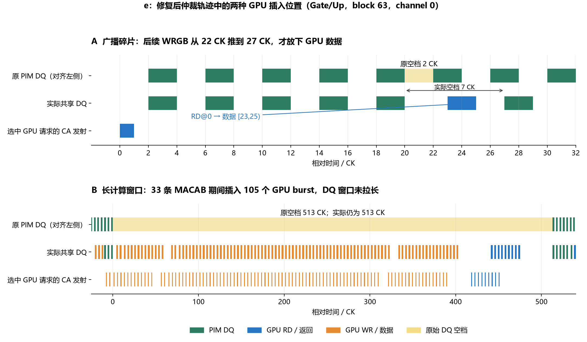

# xinyao_arbitrator：GPU/PIM 共享 CA/DQ 仲裁器

本分支发布修复后的因果仲裁器、完整重放输入、融合前后 c–g 结果，以及 e 的 GPU 访存插入统计。修复了 **WRGB→RD 的 2 CK 发射间隔**和普通跨 rank **RD→WR 的 15 CK 发射间隔**遗漏；命令发射与延迟 DQ 返回分别检查。

这是独立的 CPU 时序重放模型。GPU mover kernel/SM 竞争、cache 驻留/补充、实际地址与 warp 调度尚未建模，结果不是 Thor 并发硬件实测。原有均匀到达、连续地址与 L2 写流量代理假设均保留。

## 入口

| 内容 | 位置 |
|---|---|
| 模型机制、输入、复现与边界 | [仲裁器说明](experiments/pi05-unified-gemv/ARBITRATOR.zh-CN.md) |
| 当前仲裁实现 | [sequential_transactions.cpp](experiments/pi05-unified-gemv/sequential_transactions.cpp)、[原生发射时序](experiments/pi05-unified-gemv/sequential_timing.h)、[行状态](experiments/pi05-unified-gemv/sequential_rows.h) |
| 修复前后 c–g 对比 | [comparison.csv](reference/evaluation-1108/native-timing-fix/comparison.csv)、[核对记录](reference/evaluation-1108/native-timing-fix/comparison.json) |
| 最新完整结果与逐 kernel/stage 明细 | [with-rows](reference/evaluation-1108/native-timing-fix/with-rows) |
| e 的 DQ 插入位置、图和统计口径 | [e 插入报告](reference/evaluation-1108/e-dq-insertion-audit/REPORT.zh-CN.md) |
| 原始 GPU 广播基线的逐空闲窗口 | [基线空闲统计](reference/evaluation-1108/gpu-broadcast-dq-idle/REPORT.zh-CN.md) |
| 原生 before 基线来源 | [job 1971385](reference/evaluation-1108/direct-before-corrected/REPORT.zh-CN.md) |
| 发布文件校验 | [SHA256SUMS.json](reference/arbitrator-publication/SHA256SUMS.json) |

## 修复后的结果

原始重跑作业 `1974571`，51 项测试通过；144 种命令对/层级关系与原生 LPDDR5XPIM 表一致。三个新增回归均能在旧库上复现失败。4,680 个 PIM 阶段的独立时间和 VLM 参考时间未变。

发布前另在独立 checkout 使用本分支入口完成作业 `1975153`（5分37秒）：51 项测试、c–g 全部 stage/placement、e 全通道统计均与快照一致。见[发布验证](reference/arbitrator-publication/validation/publication-validation.json)和[核对输出](reference/arbitrator-publication/validation/verification.json)。原始广播基线全通道 CSV 也已逐字节复现。

| 配置 | PIM 等待：旧 → 新 / ms | 总延迟：旧 → 新 / ms | 总延迟变化 / ms |
|---|---:|---:|---:|
| c：融合前 · feature GPU 广播 | 7.764477 → 8.088888 | 140.380266 → 140.682225 | +0.301959 |
| d：融合前 · token GPU | 6.345897 → 6.619480 | 136.802506 → 137.063866 | +0.261360 |
| e：融合前 · token local | 6.592487 → 6.871574 | 131.312270 → 131.639969 | +0.327699 |
| f：融合后 · token GPU | 0.111282 → 0.111282 | 137.366234 → 137.366234 | +0.000000 |
| g：融合后 · token local | 0.139953 → 0.139953 | 132.316063 → 132.316063 | +0.000000 |

总延迟沿用旧报告的参考偏差抵消口径；[原始总时长](reference/evaluation-1108/native-timing-fix/with-rows/evaluation-b-g.csv)同步保留。VLM 独立模型为 196.457296 ms，已有 GPU 计时为 104.950496 ms，抵消偏差为 91.506800 ms。该偏差很大，不能用此表确定真实硬件加速或 e/g 排序。

f/g 保留整段外部 I/O 所有权交接，所以这次修正没有改变它们的结果。混合 WRGB/RDRES 与普通访存的额外 1/2 CK DQ 保护间隔是保守扩展，不能称为原生 AttAcc 已定义的电气时序。

## e 的实际插入位置

对修复后 e 的 900 个 PIM 阶段、16 个 channel 做只读诊断，作业 `1974893`。全部阶段结果、VLM placement 和请求计数与原重跑一致。

| 原始 DQ 空档 | GPU burst 数（16 通道合计） | PIM 期间占比 | 典型位置 |
|---|---:|---:|---|
| 2 CK | 15,883,421 | 21.29% | WRGB 广播之间、RDRES 导出之间；需要扩展空档 |
| 3–16 CK | 4,233,706 | 5.67% | 主要是 RDRES→RDRES 的 6 CK 间隔 |
| 17–64 CK | 4,395,446 | 5.89% | Down 的 48 CK、普通 RD 间隔等 |
| 65–256 CK | 6,415,587 | 8.60% | Down 的 65 CK、PV 的 240 CK 等 |
| >256 CK | 43,470,420 | 58.27% | Gate/Up、O 的 496/513 CK，chain 的 1380 CK 等 |
| 阶段末尾 | 208,980 | 0.28% | 最后一笔 PIM DQ 之后、16 个 channel 均完成之前 |

分母是 PIM 尚未结束期间的 **74,607,560** 个完整 GPU DQ burst。每个 burst 为 32 B / 2 CK。原始 2 CK 空档对应位置的 burst 都需要扩展空档；长窗口中有保持长度即可容纳数据的情况，也有需要延展边界的情况。



整个已启动 VLM 前缀包含 312,053,120 个 burst，其中 237,443,252 个（76.09%）发生在对应 PIM 阶段结束之后，另有 2,308 个跨越边界。尾部执行已计入 AE GPU wait（75.419926 ms），不属于填充 PIM 空闲，上表排除了它们。

## 复现

Linux、Python 3.10+、支持 C++20 的 `g++`；无需 GPU。测试和重放使用 Python 标准库；重新绘图才需要 Matplotlib 和中文字体。

```bash
# 核对发布文件和结果恒等式
python3 experiments/pi05-unified-gemv/verify_arbitrator.py

# 编译、51 项测试、重跑 c–g，并重跑 e 的全通道插入统计
python3 experiments/pi05-unified-gemv/run_arbitrator.py --output outputs/arbitrator --audit-e

# 只编译和测试
python3 experiments/pi05-unified-gemv/run_arbitrator.py --output outputs/arbitrator --tests-only
```

新输出写入 `outputs/arbitrator`，参考数据保存在 `reference/`。入口会核对重跑结果与发布快照；若修改模型后结果不同，会明确报错。数据准备脚本与完整输入都包含在分支中，不需要访问原计算节点的绝对路径。

历史布局和原生模拟记录见 [原 xinyao_1108 首页](README-xinyao_1108.md)。当前仲裁结果以本页链接的 `native-timing-fix` 为准。
