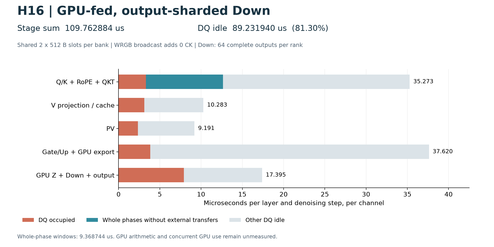

# H16：GPU 非线性与输出分片 Down 的共享 GEMV 时序复现

当前数据流为 **PIM Gate/Up → GPU GeLU 与逐元素乘法 → BF16 Z 下发 → PIM Down → GPU 完整输出**。所有 PIM GEMM 共用每 bank 两个 512 B GEMV 输入 slot。Down 按输出维分片，每 rank 负责 64 维、每 bank 负责 4 维完整输出。

本版本替代最初发布的 DRAM-Z/scatter 方案。Z 不再存入 PIM DRAM，没有 Down 列转置，也不需要 GPU 对 Down 的跨 rank 部分和求和。所有普通 GPU 输入在 WRGB 数据到达时广播到 rank 内各 bank，不额外增加广播周期；外部 DQ 传输照常计时。

## 本次原生仿真结果

H=16、batch=1、8 attention heads、head_dim=256、hidden=1024、FFN=4096。16 个 LPDDR5X-8533 channel，每个 channel 的 rank0 预留给 GPU，rank1 的 16 个 bank 执行 PIM。单位为 **µs/层/denoising step**；DQ 列为单个 channel 时间，已逐一核对 16 个 channel，本次结果一致。

| 阶段 | Latency | 模型 DQ 占用 | 模型 DQ 空闲 | 完整无外部传输工作窗口 |
|---|---:|---:|---:|---:|
| Q/K + RoPE + QKT | 35.273490 | 3.301760 | 31.971730 | 9.368744 |
| V projection/cache | 10.283294 | 3.121664 | 7.161630 | 0.000000 |
| PV | 9.190524 | 2.341248 | 6.849276 | 0.000000 |
| Gate/Up + GPU 回传 | 37.620366 | 3.842048 | 33.778318 | 0.000000 |
| GPU Z 输入 + Down + 输出 | 17.395210 | 7.924224 | 9.470986 | 0.000000 |
| **五阶段合计** | **109.762884** | **20.530944** | **89.231940** | **9.368744** |

- DQ 空闲比例 **81.30%**；完整无外部传输工作窗口比例 **8.54%**。
- 时间闭合：`109.762884 = 20.530944 + 9.368744 + 79.863196`，分别是 DQ 占用、完整工作窗口、其它 DQ 空隙。
- 全 16 channel 外部传输 **5472 KiB/层/步**。
- 五阶段合计按 18 层 × 10 步折算：**19.757319 ms**。
- 连续资源/refresh 的单层 control：**110.186860 µs**；combined FFN control：**55.037150 µs**。两项单列，不再加入五阶段合计。



**以上不等于完整 AE 端到端 latency。** GPU GeLU/multiply/cast/pack、softmax、V cast/pack、O projection、norm/residual、dispatch 及背景 VLM 尚未计时，相关结果保持 null。GPU 非线性边界保留在数据流中；连续 control 在输入再次可用时继续，仅测量 PIM 与外部传输的资源时序，没有虚构 GPU kernel 的执行时间。

DQ 使用 AttAcc 区间：WRGB/RDRES 为 issue 起 2 CK；普通 RD/WR 为 CL/CWL 后的 2 CK burst。逐 channel 检查区间无重叠。完整窗口仅包括整个阶段没有外部传输的有效工作，排除输入/输出混合阶段内的小空隙及 release-only 阶段，并扣除前序数据尾。实际 GPU 可用时间仍为 null：尚未注入 rank0 并发 GPU 请求及其造成的 CA 冲突和 rank 切换准入；PIM 自身的命令、行状态和 refresh 调度已模拟。

## FFN 布局和流量

| 算子 | 每 rank 权重 | 每 bank 权重 | 输入与输出 |
|---|---|---|---|
| Gate/Up | 两份 1024 × 256 | 两份 1024 × 16，合计 64 KiB | 所有 rank 接收 X；每 rank 输出不同的 256 个 Gate 和 Up feature |
| Down | 4096 × 64 | 4096 × 4，32 KiB | 所有 rank 接收完整 Z；每 rank 输出不同的 64 维 |

Gate/Up bank 权重位于 row128–159，Down 位于 row160–175；不再分配原 row176 的 Z 区域。Down 权重按 `[input_fragment256][output_lane4][input_lane16]` 排列。GPU Z 输入按 `[token16][feature_lane16] BF16` 分块装入共享 slot，每个 fragment 发送 16 个 32 B burst，然后每 bank 完成 4 个输出列的 MAC。256 个 fragment 覆盖全部 4096 个输入 features。

| FFN 传输，每层每步 | 全部 16 channel | 每 channel |
|---|---:|---:|
| X：GPU → Gate/Up | 512 KiB | 32 KiB |
| Gate 和 Up FP32：PIM → GPU | 512 KiB | 32 KiB |
| Z BF16：GPU → Down | 2048 KiB | 128 KiB |
| Down FP32 完整输出：PIM → GPU | 64 KiB | 4 KiB |

Z 唯一数据量为 128 KiB，向 16 个 rank 发送共 2 MiB，这部分明确占用外部带宽。每个 rank 内同时广播至 16 个 bank，不在外部 DQ 再重复计 16 次，也不另加内部广播周期。广播目的 bank 的合计写入量另列为内部统计。无需 Down 跨 rank 部分和归约。

## 从源码复现

Linux；C++20（验证环境 GCC14.2.1）、CMake>=3.18、Python3.11 及开发头文件。必要 fmt、yaml-cpp、nanobind/robin_map 源码和许可证已随附；C++ 构建不访问网络。

```bash
git clone --depth 1 --single-branch --branch xinyao_1101 https://github.com/AlinaWXY/pim_vla_simulator.git
cd pim_vla_simulator
python3 -m venv .venv
. .venv/bin/activate
python -m pip install -r requirements.txt
PYTHON="$(command -v python)" JOBS=4 bash experiments/pi05-unified-gemv/build.sh
python experiments/pi05-unified-gemv/reproduce.py --output results/fresh-h16
python verify_reference.py results/fresh-h16
```

输出目录必须不存在。建议先输出到本地 SSD，结束后复制到共享存储。默认执行 31 项单元/故障注入测试、15 项独立进程原生 guards、7 个原生案例以及地址、输入生命周期、GPU 往返依赖和逐 channel 时间审计。输出包括原始命令/GEMV 日志、trace、manifest、summary.json、channel-analysis.json、两份分解 CSV 和 CHANNEL-ANALYSIS.md。

## 模型与验证范围

- 每 bank 仅一套 `B[slot2][token16][lane16] BF16`，共 1 KiB；两个 slot 共用 MAC。无额外完整 rank 输入 SRAM、Q SRAM 或 Z SRAM/DRAM 缓存。
- 普通 WRGB 数据到达后同时填各 bank；模型只收费外部 2 CK。Q 的本地/远端定向装载仍保留原有 2 CK 内部端口时序。
- Q/K projection 为 8 CK/MAC，其它 GEMM 为 16 CK/MAC；输入完整到达和前次消费完成后才允许复用。QKT 持有 Q slot 直到 496 个本地 K 扫描完成。RoPE II=1 CK/pair、pipeline=4 CK、cast=1 CK；attention 的 rank reduction=4 CK。
- GPU 负责 GeLU、逐元素乘法及 BF16 转换/打包。计入前后的外部传输；GPU 算术和打包 latency 尚无测量值。
- 仿真检查命令、地址、路由、资源和生命周期，不计算真实 BF16 tensor 数值。
- `reference/expected.json`、`validation.json`、`provenance.json` 和 `publish-byte-verification.json` 保存新原生结果、检查结果及源码证据；`PACKAGE-MANIFEST.json` 记录发布文件哈希。历史 DRAM-Z 结果不用于当前 latency。

复现源码约 3.2 MiB，参考证据另计。没有预编译库或历史结果包。后端保留未启用的旧 Z 接口以兼容代码，但本实验显式禁用该模式并拒绝 Z_DRAM/scatter 事件。
