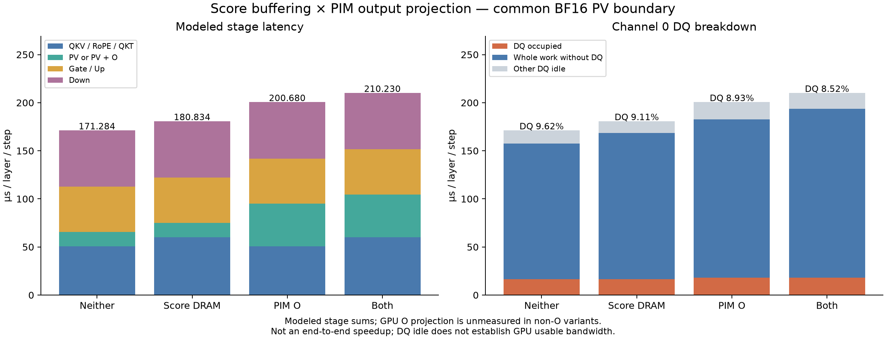

# xinyao_1104_O_Projection：QKT score 暂存与 PIM O projection

在 `xinyao_1104` 基础上实现两个独立开关，并在 dev0 完成四组原生模拟。实验 1：每处理 16 个本地 K token，将 score tile 写回 DRAM，全部完成后统一读取到 GPU。实验 2：PV 部分结果写回 DRAM，经 bank0/4 读出并广播到 16 bank，执行 O projection。

四组共同采用 PV/O 的 BF16 输入、权重和结果，FP32 累加；QKT score 保持 FP32。下表为每层、每 denoising step 的**内存/PIM 模型时间**，由 QKV/RoPE/QKT、PV 或 PV+O、Gate/Up、Down 四个独立阶段相加。非实验 2 组未计 GPU O projection，所有组未计 GPU softmax、最终跨 rank 求和等算术，因此不能直接解读为端到端加速比较。

| 组合 | 模型 latency (µs) | 相对非1非2 (µs) | DQ busy/ch0 (µs) | DQ utilization/ch0 | 外部 DQ 总量 (KiB) |
|---|---:|---:|---:|---:|---:|
| 非1非2 | 171.284428 | 0 | 16.478784 | 9.621% | 4392 |
| 1非2 | 180.834206 | +9.549778 | 16.478784 | 9.113% | 4392 |
| 2非1 | 200.680410 | +29.395982 | 17.919552 | 8.929% | 4776 |
| 1和2 | 210.230188 | +38.945760 | 17.919552 | 8.524% | 4776 |



详细分析见[实验报告](reference/o-projection/REPORT.zh-CN.md)，机器可读数据包括[四组汇总](reference/o-projection/comparison.json)、[各阶段](reference/o-projection/stage-comparison.csv)、[全部 16 channel](reference/o-projection/channel-comparison.csv)、[逐 phase](reference/o-projection/phase-comparison.csv)。

实验 1 不减少外部 score 字节数，增加本地写回和最终普通 DRAM 读取，改变 DQ 发生的时机。实验 2 在各 rank 上先投影、最后交给 GPU 求和，导出的 BF16 部分结果由 128 KiB 变成 512 KiB，外部 DQ 增加 384 KiB。DQ 百分比下降也受到模型总时间增长影响，不能单凭该比例判断流量减少或性能改善。

原 QKT 每计算 16 个 K token 就导出 1 KiB FP32 score tile，计算和导出交替，因此 QKT 整段中的 DQ 不是持续为零。实验 1 将逐 tile 的外部导出变成本地写回，最后统一读出。具体说明与时间线见报告。

当前 PV 每个 rank 保留某个 head 的 token 奇/偶分片部分和，因此线性 O projection 可以在 rank 内先执行，再对 8 heads × 2 parity 的结果求和。每 rank 配置完整 `[2048,1024]` BF16 W_O 常驻副本（4 MiB/rank、共 64 MiB），当前计算只访问本 head `[256,1024]` 子块（共 8 MiB 活跃权重）。其余权重预置且不访问；初始化时间不计入本次稳态实验。完整常驻布局在测量后补充，20 组 trace 与配置的精确一致性证明见[来源绑定](reference/o-projection/source-result-binding.json)。

原生运行 job `1924418` 包含四组各 5 案例，以及新版 backend 的 5 个旧模式回归案例。最终 141 项 Python 测试、52 项旧 native guards、8 项 score guards、13 项 O guards 通过；其中 O 的一项报错文字断言经过单项重试，原失败与修正记录均保留。验证包含所有 16 channel 的命令/地址覆盖、ACT1/ACT2、CA/DQ 冲突、SRF/累加器容量、scratch 与 DRAM 生命周期。详见[验证](reference/o-projection/validation.json)和[补充验证](reference/o-projection/postchecks/summary.json)。

```bash
PYTHON="$(command -v python)" JOBS=4 bash experiments/pi05-unified-gemv/build.sh
python experiments/pi05-unified-gemv/reproduce_o_projection.py --output results/four-way
python experiments/pi05-unified-gemv/reproduce.py --skip-tests \
  --cases chain pv gate_up_gpu down_gpu_input serial_layer_control --output results/legacy
python experiments/pi05-unified-gemv/validate_o_projection_results.py \
  --experiment results/four-way --legacy results/legacy --reference reference
```

布局、资源成本和建模范围见[O-PROJECTION.md](experiments/pi05-unified-gemv/O-PROJECTION.md)。这是时序与数据映射模型，没有执行神经网络 tensor 数值；BF16 部分结果舍入与求和顺序的精度影响尚未验证。原始事件和源码快照归档位于本地 `results/o-projection-1924418/`，SHA256 见[归档清单](reference/o-projection/archive-manifest.json)。此前 token-PV 版本的 FP32 输出结果保留在[历史 README](README-pv-token.md)及原 `reference/` 中，不作为本次四组的共同 BF16 基线。
