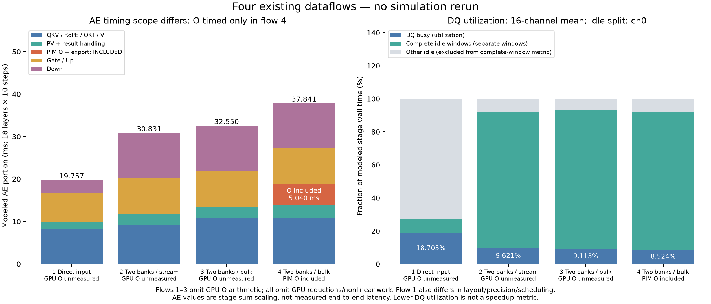

# xinyao_1108：布局、RoPE 与空闲窗口 Evaluation

本分支已汇总仿真结果、冻结输入和复现代码。当前入口及模型边界见[仲裁器复现说明](experiments/pi05-unified-gemv/ARBITRATOR.zh-CN.md)，逐 burst 插入位置见[e 的 DQ 插入审计](reference/evaluation-1108/e-dq-insertion-audit/REPORT.zh-CN.md)。Linux 下使用 Python 3.10+、g++（C++20），从仓库根目录执行：

```bash
python3 -m venv .venv
. .venv/bin/activate
python -m pip install pyyaml
python experiments/pi05-unified-gemv/run_arbitrator.py --output outputs/arbitrator --audit-e
python experiments/pi05-unified-gemv/verify_arbitrator.py --results outputs/arbitrator/with-rows --audit outputs/arbitrator/e-dq-insertion-audit
```

上述入口会编译、运行 51 项事务测试、重算 b–g 并核对逐阶段/逐 kernel 结果及 e 的全通道插入统计；无需原 SSH 服务器上的绝对路径或再次采集 GPU。原生 PIM 与 GPU 采集脚本、历史结果和撤回说明继续保留。完整发布文件按 [SHA256 清单](reference/arbitrator-publication/SHA256SUMS.json)核验；历史运行清单中的二进制由本机重新编译，不随 Git 分发。

**融合前基线已按用户定义修正：无 rank controller、无输入 DRAM 暂存，线性算子计算期间持续由 GPU 通过 WRGB 广播输入，占用外部 DQ 与共享 CA。融合后才使用 rank controller、DRAM 暂存与粗命令。**

此前 job1971246 的 before 错误地保留 rank controller 和 PV→O 本地输入路径，其 before DQ/CA 表、e/g 比较及受影响的串行/并行 latency 均撤回，旧文件只作误配置归档。ρ、在途数和读写比的合成假设也不再用于 Evaluation。

新的原生数据、配置检查和逐算子 CA/DQ 分析见[修正基线报告](reference/evaluation-1108/direct-before-corrected/REPORT.zh-CN.md)。**随后“任何正长 joint idle 都按原速推进 GPU”的 c–g 并行 latency 与 overlap 点值也撤回，不再作为有效 Evaluation。** 该近似没有关联 RD 命令发射与 CL 之后的 DQ 返回预留；kernel 顺序与 AE 等待的数值对账不能证明访存可执行。原生 PIM/DQ/CA 数据及串行 b 的已有计费结果不因这一缺陷失效。[历史算法报告与撤回原因](reference/evaluation-1108/corrected-overlap/REPORT.zh-CN.md)保留旧输出；[延迟返回冲突诊断](reference/evaluation-1108/delayed-read-audit/audit.json)只检查单次假想 row-hit RD 的必要条件，不生成 GPU 流量或新的 latency。

按后续授权的**均匀访存假设**，已补采全部 2353 个 VLM kernel 的独立单 pass 读/写计数，不使用人为的 ρ、在途上限或读写比。[当前因果总线模型与 b–g 表](reference/evaluation-1108/online-arbitration-preparation/REPORT.zh-CN.md)区分两类机制：c–e 在线检查 CA 发射、延迟 DQ 返回、读写切换与 refresh，已提交 GPU 返回不可撤销，未发射 PIM 请求优先；f/g 的本地细命令与外部 CA 隔离，整个外部输入/输出阶段采用所有权交接。保留 kernel 顺序、跨窗口执行和后续 AE GPU 等待，并计入 GPU 对 PIM 的反压。独立 GPU 参考也使用同一个因果仲裁器核对。

本轮 AE 原 GPU 算子改用已有自然缓存 trace，替换此前逐 kernel 清缓存的计时，仍是未融合的 OpenPI eager、带 profiler 的设备时长。**结果属于条件模型估计，未接入原生控制器，也不是 Thor 硬件端到端实测。** L2 写代理、row-hit/均匀映射、请求检查点和命令间隔重放的局限随报告列出。[此前的固定未来日历模型](reference/evaluation-1108/uniform-transactions/REPORT.zh-CN.md)及其 CA/DQ 消融只保留历史溯源；它使用固定 PIM 时间线和旧 AE 冷缓存计时，不再作为当前主表。

后续已要求替换均匀/全 row-hit 假设。Thor 上的 NVBit 地址采集和 CUPTI L2 时间序列小测试已通过：[逐地址验证](reference/evaluation-1108/thor-trace-feasibility/validation.json)、[已完成与缺失项](reference/evaluation-1108/thor-trace-feasibility/scope.json)。**这不等于已取得 Pi0.5 全量 MC trace。** 目标仍是 Thor＋LPDDR，未改用 A100/H100 的 HBM 数据。

已按现有 LPDDR5X 配置补入连续地址下的 GPU ACT1/ACT2、PREpb、refresh 前 PREab 和 bank/row 时序，并完成 b–g 与相同地址映射的 row-hit 对照：[ACT/PRE 修正报告](reference/evaluation-1108/sequential-rows/REPORT.zh-CN.md)。43 项测试和 81 项文件哈希核验通过。**独立 VLM 模型为 196.457 ms，明显偏离已有 104.950 ms 计时；新增表仍是模型诊断，不能作为真实 Thor 延迟或 e/g 排序结论。** 时间到达仍为均匀近似，写侧仍是 L2 write sectors 代理；尚未恢复实际 GPU 访存突发。

最新仲裁时序修正已通过 job `1974571` 重跑 c–g：[修正前后数值](reference/evaluation-1108/native-timing-fix/comparison.csv)、[原生时序核对与模型边界](reference/evaluation-1108/native-timing-fix/comparison.json)。修复了只检查延迟 DQ 返回、遗漏独立命令发射约束的问题：WRGB→RD 跨 rank 至少 2 CK，普通跨 rank RD→WR 至少 15 CK，并把这些约束纳入已就绪 PIM 的优先保护。51 项测试、144 种命令对/层级关系的原生表对照通过；三个新增回归在旧库上均复现失败。c 的 PIM 等待由 7.764477 增至 8.088888 ms，总延迟由 140.380266 增至 140.682225 ms；d/e 总延迟分别增至 137.063866/131.639969 ms；f/g 保留整段外部 I/O 独占策略，结果未变。4,680 个 PIM 阶段的独立时长与 VLM 参考偏差不变。混合 WRGB/RDRES 与普通访存的额外 DQ 保护间隔仍是保守扩展；GPU 搬运 kernel/SM 竞争和输入 cache 驻留尚未建模。旧表保留作对照，当前结果仍限于上述模型诊断口径。复跑入口为 `experiments/pi05-unified-gemv/native-timing-fix.sbatch`。

## xinyao_1107 历史记录：MAC_RUN / ROPE_RUN 粗细命令

新版本在原有 layout、本地 RoPE、QKT score 集中导出和 PIM O projection 上调整命令接口。计算统一为每 rank 每算子一条256-bit描述符，QKᵀ和O各一条；输入、结果和跨rank搬运保留直接DQ读写。字段、CA周期、执行语义和复现命令见[粗细命令说明](experiments/pi05-unified-gemv/COMMANDS.zh-CN.md)，原生前后对比与图见[本次报告](reference/commands-1107/REPORT.zh-CN.md)。

以下保留调整前的历史实验记录。

## 四条历史数据流比较（仅分析已有记录）

最新比较按用户指定的四条路径排列，复用原生 jobs `1903036`、`1924418`，未重跑仿真。完整表格、DQ 时间线、DQ/CA 最长单段空闲及来源见[四条路径报告](reference/dataflow-comparison/REPORT.zh-CN.md)。

| 路径 | 已建模 AE 部分 / ms（18层×10步） | O projection 是否计时 | DQ utilization（16-channel平均） |
|---|---:|---|---:|
| ① 直接广播至 GEMV buffer | 19.757319 | GPU O 未计时 | 18.705% |
| ② 两 bank 暂存，score 流式导出 | 30.831197 | GPU O 未计时 | 9.621% |
| ③ 两 bank 暂存，score 集中导出 | 32.550157 | GPU O 未计时 | 9.113% |
| ④ 同③，PIM O projection | 37.841434 | 已计 PIM O：5.039536 ms | 8.524% |

上表是独立单层阶段和的外推，**不是完整 AE 端到端测量**。①另有 QKV 融合、PV 分片、输出精度和调度差异，因此①→②不是单独改变输入路径的消融。



主窗口指标不累计碎片：DQ 取最长完整工作窗口；CA 取最长实际单段空闲；joint 取完整 DQ 工作范围内最长的一段 DQ/CA 同时空闲。QKT 的 DQ 最长窗口①②③④分别为 `0.490574 / 0.559048 / 19.383770 / 19.383770 µs`，其中①②各为31个分离窗口，不能相加称为连续时间。②③④虽然都有47.638206 µs的Down DQ完整窗口，但共享CA最长单段仅1.093708 µs。

## 原有两个开关的2×2实验

在 `xinyao_1104` 基础上实现两个独立开关，并在 dev0 完成四组原生模拟。实验 1：每处理 16 个本地 K token，将 score tile 写回 DRAM，全部完成后统一读取到 GPU。实验 2：PV 部分结果写回 DRAM，经 bank0/4 读出并广播到 16 bank，执行 O projection。

四组共同采用 PV/O 的 BF16 输入、权重和结果，FP32 累加；QKT score 保持 FP32。**主比较改为最长连续完整工作窗口，而非累计无 DQ 时间；实验 2 的时延包含 PV 和 PIM O projection。** 此前累计口径的报告保留在 [previous-cumulative-report](reference/o-projection/previous-cumulative-report/)。

下表为 channel 0 在各工作范围内的**最长一个连续、无外部 DQ 的完整工作窗口**，单位 µs。窗口由完整计算/本地操作阶段组成；相邻阶段之间若只有无 DQ 的控制段则连接，遇到外部传输阶段即分开。传输阶段内部的 DQ idle 小间隙不计入，也不跨独立案例拼接。

| 工作范围 | 非1非2 | 1非2 | 2非1 | 1和2 |
|---|---:|---:|---:|---:|
| QKT | 0.559048 | 19.383770 | 0.559048 | 19.383770 |
| PV；实验 2 为 PV+O | 11.784094 | 11.784094 | 25.124330 | 25.124330 |
| Gate / Up | 40.757038 | 40.757038 | 40.757038 | 40.757038 |
| Down | 47.638206 | 47.638206 | 47.638206 | 47.638206 |

实验 1 将 QKT 的 31 个分离窗口变为 1 个连续窗口；实验 2 的 PV+O 有 2 个窗口，最长为 25.124330 µs，不能把两者相加称为连续。完整 QKV/RoPE/QKT/V chain 的最长窗口四组均为 32.435102 µs，会掩盖 QKT 的变化，因此单列 QKT。窗口包含本地等待、refresh 和内部控制，不等于 MAC 活跃时间，也不是已测 GPU 可用时间。完整数据见 [continuous-dq.json](reference/o-projection/continuous-dq/continuous-dq.json)、[范围汇总](reference/o-projection/continuous-dq/continuous-dq-summary.csv)和[逐连续工作窗口](reference/o-projection/continuous-dq/continuous-dq-complete-work-windows.csv)。

以下 latency 与 DQ utilization 保留作总量核算。时间为每层、每 denoising step 的**内存/PIM 模型时间**，由 QKV/RoPE/QKT、PV 或 PV+O、Gate/Up、Down 四个独立阶段相加；它不是一个连续窗口。非实验 2 组未计 GPU O projection，所有组未计 GPU softmax、最终跨 rank 求和等算术，因此不能直接解读为端到端加速比较。

| 组合 | 模型 latency (µs) | 相对非1非2 (µs) | DQ busy/ch0 (µs) | DQ utilization/ch0 | 外部 DQ 总量 (KiB) |
|---|---:|---:|---:|---:|---:|
| 非1非2（GPU O 未计时） | 171.284428 | 0 | 16.478784 | 9.621% | 4392 |
| 1非2（GPU O 未计时） | 180.834206 | +9.549778 | 16.478784 | 9.113% | 4392 |
| 2非1（已计 PIM O） | 200.680410 | +29.395982 | 17.919552 | 8.929% | 4776 |
| 1和2（已计 PIM O） | 210.230188 | +38.945760 | 17.919552 | 8.524% | 4776 |


详细分析见[实验报告](reference/o-projection/REPORT.zh-CN.md)，机器可读数据包括[四组汇总](reference/o-projection/comparison.json)、[各阶段](reference/o-projection/stage-comparison.csv)、[全部 16 channel](reference/o-projection/channel-comparison.csv)、[逐 phase](reference/o-projection/phase-comparison.csv)。

PV 基线为 14.953596 µs，实验 2 的 **PV+O 为 44.349578 µs**。其中 O 子流程为 27.997424 µs：读取/广播/计算 20.257986、结果导出 7.731934、控制 0.007504；另有 PV 结果落 DRAM 的 3.320520 µs。相对基线净增 29.395982 µs，还扣除了被替换的 PV 导出 1.921962 µs，因此该差值不是纯 O 耗时。

实验 1 不减少外部 score 字节数，增加本地写回和最终普通 DRAM 读取，改变 DQ 发生的时机。实验 2 在各 rank 上先投影、最后交给 GPU 求和，导出的 BF16 部分结果由 128 KiB 变成 512 KiB，外部 DQ 增加 384 KiB。DQ 百分比下降也受到模型总时间增长影响，不能单凭该比例判断流量减少或性能改善。

原 QKT 每计算 16 个 K token 就导出 1 KiB FP32 score tile，计算和导出交替，因此 QKT 整段中的 DQ 不是持续为零。实验 1 将逐 tile 的外部导出变成本地写回，最后统一读出。具体说明与时间线见报告。

当前 PV 每个 rank 保留某个 head 的 token 奇/偶分片部分和，因此线性 O projection 可以在 rank 内先执行，再对 8 heads × 2 parity 的结果求和。每 rank 配置完整 `[2048,1024]` BF16 W_O 常驻副本（4 MiB/rank、共 64 MiB），当前计算只访问本 head `[256,1024]` 子块（共 8 MiB 活跃权重）。其余权重预置且不访问；初始化时间不计入本次稳态实验。完整常驻布局在测量后补充，20 组 trace 与配置的精确一致性证明见[来源绑定](reference/o-projection/source-result-binding.json)。

原生运行 job `1924418` 包含四组各 5 案例，以及新版 backend 的 5 个旧模式回归案例。原实验的 141 项 Python 测试和 73 项 native guards（52 项旧 guards、8 项 score guards、13 项 O guards）通过；其中 O 的一项报错文字断言经过单项重试，原失败与修正记录均保留。验证包含所有 16 channel 的命令/地址覆盖、ACT1/ACT2、CA/DQ 冲突、SRF/累加器容量、scratch 与 DRAM 生命周期。详见[原实验验证](reference/o-projection/validation.json)、[补充验证](reference/o-projection/postchecks/summary.json)；本次连续窗口分析的新增测试另见[连续窗口复核](reference/o-projection/continuous-review-validation.json)。

```bash
PYTHON="$(command -v python)" JOBS=4 bash experiments/pi05-unified-gemv/build.sh
python experiments/pi05-unified-gemv/reproduce_o_projection.py --output results/four-way
python experiments/pi05-unified-gemv/reproduce.py --skip-tests \
  --cases chain pv gate_up_gpu down_gpu_input serial_layer_control --output results/legacy
python experiments/pi05-unified-gemv/validate_o_projection_results.py \
  --experiment results/four-way --legacy results/legacy --reference reference
```

布局、资源成本和建模范围见[O-PROJECTION.md](experiments/pi05-unified-gemv/O-PROJECTION.md)。这是时序与数据映射模型，没有执行神经网络 tensor 数值；BF16 部分结果舍入与求和顺序的精度影响尚未验证。原始事件和源码快照归档位于本地 `results/o-projection-1924418/`，SHA256 见[归档清单](reference/o-projection/archive-manifest.json)。此前 token-PV 版本的 FP32 输出结果保留在[历史 README](README-pv-token.md)及原 `reference/` 中，不作为本次四组的共同 BF16 基线。
