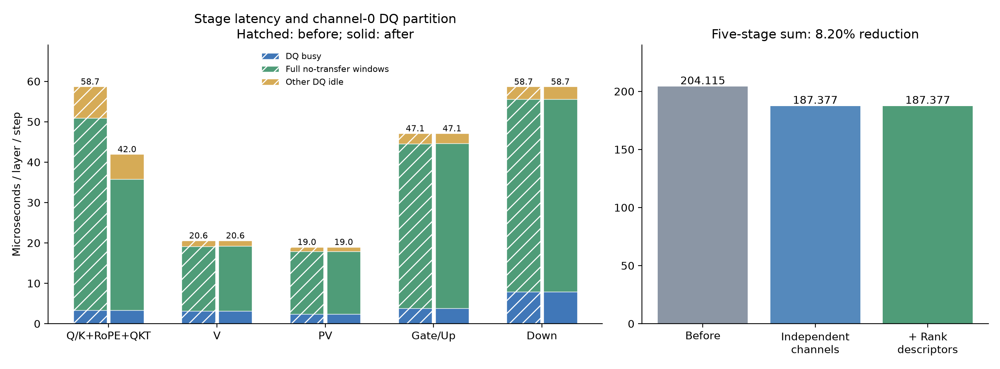

# xinyao_1103：独立 channel 派发与 rank 粗指令

在双 bank 暂存版本 `786842a` 上修正跨 channel 队头阻塞，并将逐 bank 的 RoPE、projection spill、Q export/remote 循环下沉到 rank controller。旧版本保留在 Git 历史与本地 bundle，紧凑数据保存在 [previous-rank-dispatch](reference/previous-rank-dispatch/summary.json)。

每个 channel 有独立的32项入口FIFO；请求入队不占CA，实际派发最多每channel每memory CK一次，并接受外层CA与下游队列背压。前端在barrier/既有完成栅栏之间维护独立channel指令流。一个channel阻塞不再阻止其它channel入队。Q转发依赖绑定具体的源EXPORT请求实例，显式BARRIER、WAIT及原有普通/PIM切换完成栅栏保留。

`PIM_RANK_SPILL`、`PIM_RANK_ROPE_COEF/LOAD/EXEC/STORE`、`PIM_RANK_Q_EXPORT/REMOTE`各用一次外层CA派发，由rank controller展开16个bank微请求。父请求必须等16个微请求全部完成；微请求保留真实rank CA、DRAM行状态、DQ和SRF依赖。Q导出的内部RD仍走原ordinary scheduler及完整读时序，但其命令归属rank CA。原MAC计算指令和STAGE_FRAGMENT展开保持原样。

## 原生 latency 对比

单位µs/层/denoising step。H16、batch1、16个LPDDR5X-8533 channel；每channel rank0预留GPU、rank1有16个PIM bank。四种模式均使用同一原生库重新运行，比较不依靠估算扣除。

| 阶段 | 修改前 | 仅独立channel | 两项均修正 | 缩短 |
|---|---:|---:|---:|---:|
| Q/K + RoPE + QKT | 58.708482 | 41.969872 | 41.969872 | 16.738610 |
| V | 20.592852 | 20.592852 | 20.592852 | 0.000000 |
| PV | 18.994500 | 18.994500 | 18.994500 | 0.000000 |
| Gate/Up | 47.127934 | 47.127934 | 47.127934 | 0.000000 |
| Down | 58.691598 | 58.691598 | 58.691598 | 0.000000 |
| **合计** | **204.115366** | **187.376756** | **187.376756** | **16.738610** |

总latency减少 **8.20%**。18层×10步折算 **33.727816ms**，修改前为36.740766ms；这是已建模阶段之和，未计GPU算术等完整AE端到端开销。单层连续控制为188.328826µs，combined FFN控制为105.910518µs，不重复计入主结果。

本次全部7个案例中，仅独立channel与两项均修正的latency相同。因而本次latency改善可归于消除前端跨channel阻塞；rank粗描述符降低外层CA占用，但保留了相同的细指令与数据依赖，没有进一步缩短本工作负载的临界路径。

## Q/K、RoPE、QKT 内部阶段

| 子阶段 | 修改前 | 仅独立channel | 两项均修正 |
|---|---:|---:|---:|
| Q/K输入写入 | 1.246631 | 1.245693 | 1.245693 |
| Q/K暂存读取＋计算 | 22.533574 | 22.533574 | 22.533574 |
| Projection spill | 3.895514 | 0.368634 | 0.385518 |
| RoPE | 12.652682 | 0.902356 | 0.885472 |
| Q导出 | 4.238822 | 4.029648 | 4.029648 |
| Q跨channel填充 | 1.847860 | 0.481194 | 0.481194 |
| QKT计算 | 8.529234 | 8.710268 | 8.710268 |
| QKT结果输出 | 3.758566 | 3.692906 | 3.692906 |

所有阶段（包括V、PV、Gate/Up、Down的输入、内部计算与输出）及边界时间见 [完整子阶段CSV](reference/rank-dispatch-phase-comparison.csv)。分组时间来自barrier，不是把可能重叠的请求延迟相加。消融差值也包含refresh相位和行状态变化，不能全部视作某一条总线的独立成本。

## DQ 空闲时间 breakdown

下表展示channel0，全部16channel独立审计并保存在CSV。外部数据量和DQ占用未变；完整无传输窗口已扣除边界数据尾部，其它DQ空闲包括传输阶段内的间隙。

| 阶段 | DQ占用（前后相同） | 修改前DQ空闲 | 修改后DQ空闲 | 修改后完整无传输窗口 | 修改后其它DQ空闲 |
|---|---:|---:|---:|---:|---:|
| Q/K + RoPE + QKT | 3.301760 | 55.406722 | 38.668112 | 32.514832 | 6.153280 |
| V | 3.121664 | 17.471188 | 17.471188 | 16.065126 | 1.406062 |
| PV | 2.341248 | 16.653252 | 16.653252 | 15.588622 | 1.064630 |
| Gate/Up | 3.842048 | 43.285886 | 43.285886 | 40.757038 | 2.528848 |
| Down | 7.924224 | 50.767374 | 50.767374 | 47.638206 | 3.129168 |
| **合计** | **20.530944** | **183.584422** | **166.845812** | **152.563824** | **14.281988** |

时间闭合：`187.376756 = 20.530944 + 152.563824 + 14.281988`。总外部流量仍为5472KiB/层/步（16channel合计）。运行变短，因此绝对DQ空闲时间也减少；未注入并发GPU工作，这些窗口是资源可用上界，不能直接当作GPU实际获益。



[逐channel前后DQ与CA对比](reference/rank-dispatch-channel-comparison.csv)、[逐阶段窗口](reference/channel-phase-windows.csv)、[CA占用](reference/channel-command-bus.csv)、[完整JSON](reference/rank-dispatch-comparison.json)、[可导出PDF图](reference/rank-dispatch-comparison.pdf)。外层CA的`global`日志字段作用域是每个channel，并非16channel共享一条总线。

下表是channel0的命令资源分解，单位µs。DQ空闲的后两项相加等于DQ总空闲；不同总线的占用不能彼此相加当作latency。

| 资源 | 修改前 | 仅独立channel | 两项均修正 |
|---|---:|---:|---:|
| 外层CA占用 | 18.706534 | 18.692464 | 17.304224 |
| rank1 CA占用 | 34.907670 | 34.778226 | 34.778226 |
| DQ空闲、外层CA忙 | 9.527266 | 9.463482 | 8.170918 |
| DQ与外层CA同时空闲 | 174.057156 | 157.382330 | 158.674894 |

## 保留的资源和验证

双bank DRAM暂存仍为BG0/B0与BG1/B0，各64KiB；每bank SRF仍为2×512B。没有增加数据buffer容量、减少计算量、放宽DRAM时序或取消细CA竞争。计算、读取、广播和输出保留真实依赖；输入全部落地与写恢复完成后才能开始暂存读取。GPU softmax、GeLU/multiply、packing、O projection、norm/residual与背景VLM竞争未计时，模型不执行BF16数值计算。

原生job 1902756通过 **81项Python测试、38项原生guards、28个完整case运行**（7个新模式、7个修改前兼容模式、7个仅独立channel、7个1101直接输入）。兼容模式的周期、外部字节、trace和原始事件CSV哈希与`786842a`完全一致；1101兼容检查也通过。新模式审计有界FIFO、逐channel独立推进、全部barrier和peer依赖、16个唯一bank微请求完成、CA无冲突、DQ时间闭合。实验/backend/vendor的505个文件与最终原生运行快照逐字节一致。

另有独立只读审计核对10240个Q_EXPORT子回调均覆盖对应SRF写完成，含晚到peer和重复地址实例：[审计证据](reference/independent-srf-review.json)。

## 复现

```bash
PYTHON="$(command -v python)" JOBS=4 bash experiments/pi05-unified-gemv/build.sh
python experiments/pi05-unified-gemv/reproduce.py --output results/fresh
python verify_reference.py results/fresh
python experiments/pi05-unified-gemv/reproduce.py --output results/legacy --legacy-rank-dispatch --skip-tests
python verify_legacy_rank_dispatch.py results/legacy
python experiments/pi05-unified-gemv/reproduce.py --output results/independent --no-rank-descriptors --skip-tests
python compare_rank_dispatch.py results/fresh --before results/legacy --dispatch-only results/independent --plot
```

Linux、C++20、CMake≥3.18、Python3.11及开发头文件；Python依赖见requirements.txt。[模型细节](experiments/pi05-unified-gemv/MODEL.md)、[RoPE控制路径](experiments/pi05-unified-gemv/ROPE-CONTROL.md)。旧单bank或双bank比较脚本针对历史模式；重现1102时需同时指定`--staging-banks 1 --legacy-rank-dispatch`。
