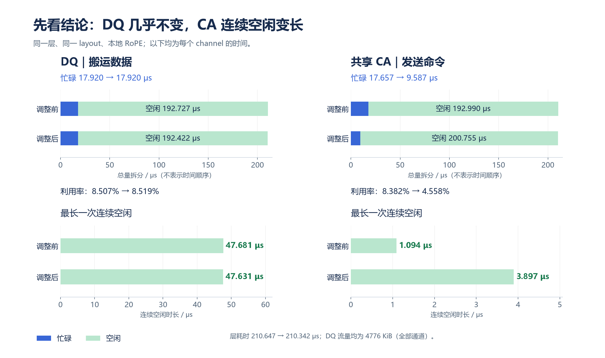
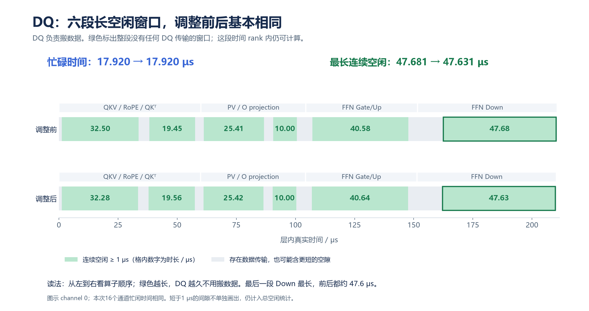
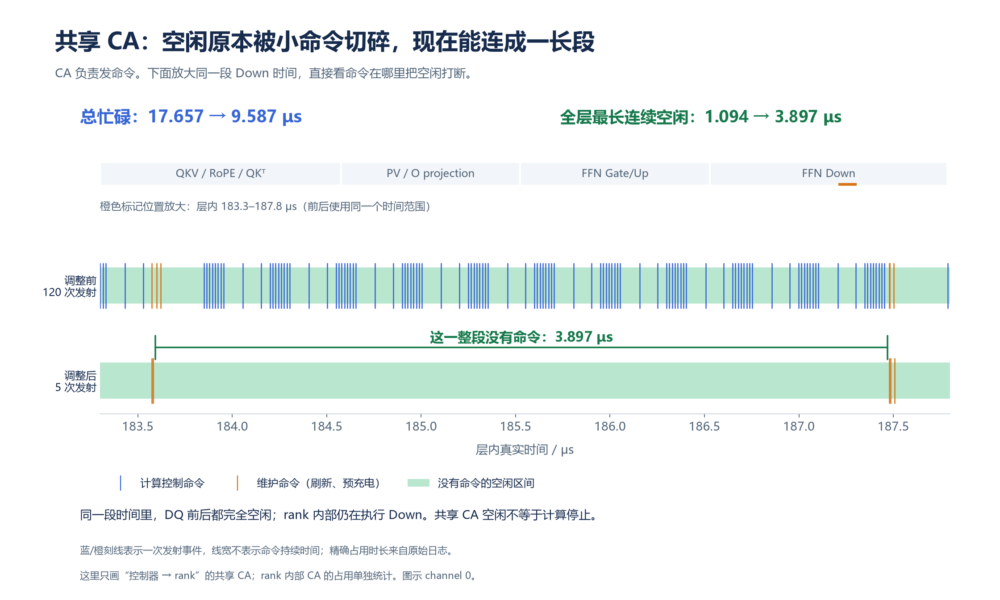

# xinyao_1107：粗细命令调整前后比较

已备份调整前的 `xinyao_1104_O_Projection`（`9daeaf365dbfd09594b3ff3a3f2b6129cf4c234c`），在独立工作树和分支 `xinyao_1107` 实现新接口。两组使用相同 layout、本地 RoPE、两 bank 暂存、QKV 融合、token 分片 PV、score 集中导出与 PIM O projection。没有改变 tensor 字节量、SRF/输出池容量、MAC 数量、归约顺序或 DRAM timing。

**主要变化是释放共享 CA：CA busy 时间减少45.702%，最长连续空闲由1.094µs增至3.897µs。连续层 latency 下降0.145%，DQ 流量保持4776KiB。**

## 连续层结果

这张表来自各自一次完整 `serial_layer_control` 原生模拟，不是拼接独立案例。利用率和累计空闲按16-channel平均；最长一段为16个channel同时空闲的实际连续区间。此次16个channel的调度一致，因此同时空闲值与各channel值相同。

| 指标 | 调整前 | 调整后 |
|---|---:|---:|
| 连续层 latency / µs | 210.646660 | 210.341810 |
| 外部 DQ 总流量 / KiB（全部channel） | 4776 | 4776 |
| DQ busy / µs/channel | 17.919552 | 17.919552 |
| DQ utilization | 8.506924% | 8.519253% |
| DQ 总空闲 / µs/channel | 192.727108 | 192.422258 |
| DQ 最长连续空闲 / µs | 47.681354 | 47.630702 |
| 全局 CA busy / µs/channel | 17.656912 | 9.587298 |
| 全局 CA utilization | 8.382242% | 4.557961% |
| 全局 CA 总空闲 / µs/channel | 192.989748 | 200.754512 |
| 全局 CA 最长连续空闲 / µs | 1.093708 | 3.897390 |
| DQ与全局CA同时空闲总量 / µs/channel | 183.331162 | 191.321046 |
| DQ与全局CA同时空闲最长一段 / µs | 1.093708 | 3.897390 |
| rank1 CA utilization | 18.385359% | 13.347009% |
| rank1 CA 总空闲 / µs/channel | 171.918516 | 182.267470 |
| rank1 CA 最长连续空闲 / µs | 0.208236 | 0.208236 |

DQ busy 时间完全相同；总运行时间略短，所以DQ利用率略升、累计空闲略降。共享CA少发计算/本地操作的旧式控制请求，长空闲窗口明显增加，但实际数组取数和乘加仍需执行，因此 latency 改善很小。全局CA的连续空闲仍被维护命令及实际传输打断，不能把几十µs的DQ空闲直接视作同样长的CA空闲。

下面先把“总空闲”与“最长一次连续空闲”分开看。DQ搬数据，共享CA发命令。上排是总量拆分，不是时间顺序；下排只比较最长一段，两个资源各有自己的横轴刻度。

## DQ Utilization 与合并后的空闲窗口

上/下分别为调整前/后，使用相同的层内真实时间轴，并标出算子所在阶段。绿色是≥1µs的完整连续空闲，格内数字为该段时长；灰色区域存在数据传输，也可能含更短的空隙。因此灰色不能直接理解成整段100%占用。六段长空闲前后基本相同，最长一段对应Down阶段。

只在真实时间轴上合并相邻/重叠区间；有DQ burst的地方一定断开。不跨独立案例、不把间隔分散的idle加起来冒充一个窗口。所有连续区间及起止时间保存在[完整空闲窗口CSV](../../../backups/xinyao_1107-idle_windows.csv.gz)。

## CA Bus 空闲

全局CA是GPU/Memory Controller与rank控制器之间的共享总线；rank1 CA是rank内部发向数组的总线。两种资源分别统计，同一次命令在两处的记录不相加成同一总线占用。

同样放大两组运行的183.3–187.8µs，共4.5µs，都位于Down阶段。调整前发射120次命令，其中114次是计算控制请求，另有6次维护；调整后仅5次维护命令。调整后中间有一整段3.897µs没有命令，而同段DQ在前后两组都完全空闲。rank内部仍在执行Down，因此共享CA空闲并不等于计算停止。

蓝/橙刻线表示发射事件，线宽不表示命令持续时间。图头的1.094µs是调整前**全层**最长空闲，不是该局部窗口的最长空闲。

需要查看全部细节时，可打开[原版全时间CA曲线](ca_idle.png)、[rank1内部CA曲线](rank_ca_idle.png)和[原版DQ利用率曲线](dq_utilization_idle.png)。新版图复用同一份原生记录，没有重跑仿真；输入哈希、总忙碌时长、最长空闲均已核对，[绘图证据](readable/plot-evidence.json)记录了放大区间及命令计数。

## 各阶段 latency

以下是独立案例，各自具有独立刷新状态；不能把这些运行的物理空闲区间拼接到连续层图中。

[各阶段latency对比图](comparison_overview.png)

| 案例 | 前 / µs | 后 / µs | 后−前 / µs |
|---|---:|---:|---:|
| QKV + 本地RoPE + Q交换 + QKᵀ/score导出 | 60.061078 | 59.892238 | −0.168840 |
| PV + 本地中间结果 + O projection/导出 | 44.349578 | 44.398354 | +0.048776 |
| FFN Gate/Up（含输入输出） | 47.127934 | 47.139190 | +0.011256 |
| FFN Down（含输入输出） | 58.691598 | 58.646574 | −0.045024 |
| 独立阶段和 | 210.230188 | 210.076356 | −0.153832 |
| 单次连续层模拟 | 210.646660 | 210.341810 | −0.304850 |

沿用旧报告“独立阶段和×18层×10步”的外推口径，已建模部分从37.841434ms变为37.813744ms；对应DQ利用率8.523777%→8.530018%。连续层×180则为37.916399ms→37.861526ms。两者的刷新/边界状态不同，因此本报告主图使用连续层结果。均未包含GPU softmax、最终归约、非线性、归一化/残差等未知算术与真实后台争用，不是完整AE端到端测量。

## 实际命令接口

- 粗计算命令只有 `MAC_RUN` 和 `ROPE_RUN`。每rank每算子一条；QKᵀ内部循环31个tile，O内部循环2个tile。
- 输入、结果、跨rank数据用实际 `WR / RD / RDRES / WRGB` 逐32B传输。没有DMA粗命令或免费大包搬运。
- `MAC`、`LOCALRD / LOCALWR`、`ACT1 / ACT2 / PREpb / PREab`及维护保留真实rank CA占用。SRF multicast、gather、cast、reduce、release、RoPE execute为本地动作，保留资源服务时间，删除虚构的CA占用。
- native timeline中的 `MACAB / MACQK` 是保留原模型的两种取数/归约时序适配类；rank CA日志统一为 `MAC`。没有通过改名取消QK归约或数组延迟。
- 每条256-bit描述符，加14-bit header、16-bit CRC、8-bit padding，共294bit；7-pin DDR CA每CK传14bit，实际占**21 CA CK**，解码另1CK。每channel一层6条MAC_RUN+1条ROPE_RUN，计算描述符合计**147 CA CK**。16个channel总计2352 channel-CK，不是串行2352CK。

完整字段、粒度、七个描述符例子、固定输出去向及复现方法见[命令设计说明](../../experiments/pi05-unified-gemv/COMMANDS.zh-CN.md)。

## 验证与证据

原生job `1966885`；审计/绘图job `1966897`。五组before/after均完成。调整前五组的trace SHA256和latency与备份中的job `1924418`、`both`配置逐项相同。

独立审计核对前后真实数据地址多重集合和MAC归约顺序，检查描述符生成的内部请求与原trace逐地址对应，以及每个子请求、每条粗指令恰好完成一次。连续层核对432128条原生数据命令、112条粗计算描述符及2352 channel-CK描述符传输。SRF覆盖/复用、输出池、PV→O生产依赖、score生命周期、写恢复、ACT2期限、DQ与两级CA无重叠检查均通过。

七个描述符通过Python编码/C++解码交叉测试；另测CRC损坏、保留位、非法geometry拒绝、QKᵀ的484槽跳转与O第二tile边界。原图与新版中文图均已作本地视觉检查。

- [完整审计结果](audit.json)、[指标JSON](metrics.json)、[原始文件SHA256](raw_sha256.json)。
- [运行来源及native二进制SHA256](provenance.json)、[当前实现源码SHA256（LF归一化）](source-sha256-lf.json)。两端修改源码归一化后逐文件一致；Python生成包装器按实际codegen顺序对齐。
- [调整前代码/原记录备份清单](../../../backups/xinyao_1107_before_9daeaf3_20261107/manifest.json)：git bundle、源代码ZIP与原生记录均保留。
- [本次原生记录归档](../../../backups/xinyao_1107-native-1966885.tar.gz)，SHA256 `5e57a80bfa56d249cb0339e6a203eaf25a0fde86b8efff89258dc9f21abc32f1`，97135994byte；已在本地验证。
- [本次归档索引](archive.json)。远端完整目录为 `/fact_data/xinyaowang/pim_vla_xinyao_1107_20261107`，原生记录位于 `final/`，图表和全部空闲CSV位于 `comparison/`。

当前模拟执行时序与所有权，不执行数值tensor；支持本文固定layout，不能据此声称任意布局的数值精度或芯片实测性能已经验证。
