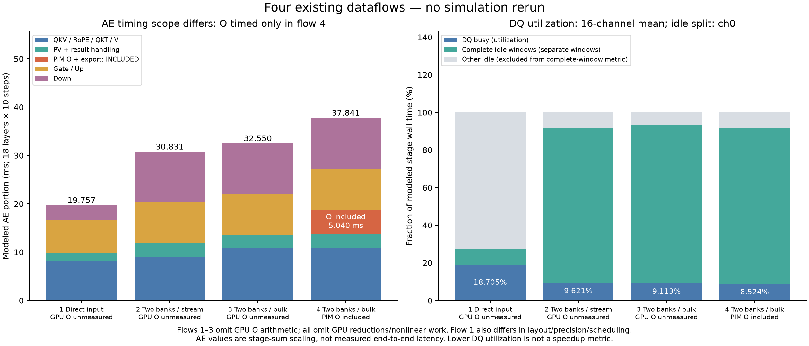
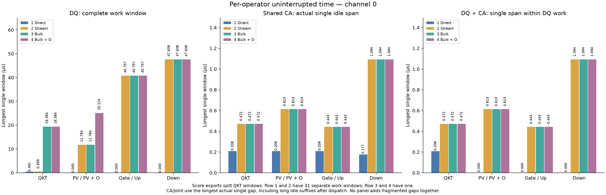
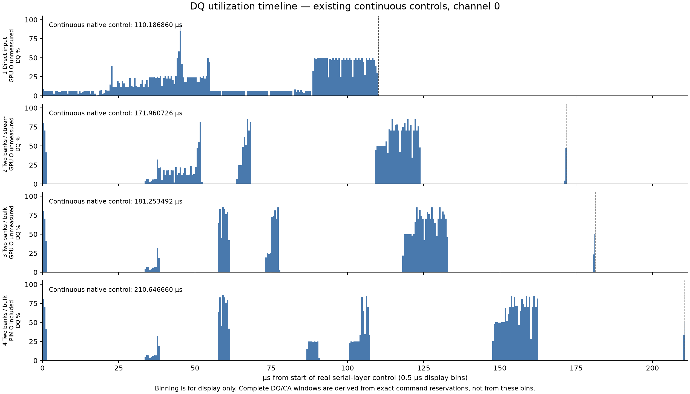

# 四种既有数据流：AE计时范围与连续DQ/CA空闲窗口

本报告比较已完成的原生模拟记录，只重新读取事件、核对来源并计算统计量，不重新运行模拟。重点是**最长单个连续区间**：DQ使用完整DQ工作窗口，CA使用实际单段空闲，joint使用完整DQ工作范围内的单段CA空闲。不把多个零碎空档或分离窗口相加称为连续时间。

耗时与DQ/CA结果已完成核验。区间分析来自 `1928983`，数值汇总来自 `1928996`，最终图版对应缓存重绘作业 `1929027`；这些作业都不是新模拟。集中score导出把QKT完整DQ窗口从31段变为1段，最长由第2种的 **0.559048 µs** 增至第3种的 **19.383770 µs**；但CA仍在其中发令，不能把这19.383770 µs当作DQ与CA同时空闲。

## 1. 四种数据流

| 编号 | 输入路径 | QKT结果路径 | O projection路径 | 既有数据来源 |
|---|---|---|---|---|
| 1 | 外部DQ直接广播到bank内GEMV双缓冲，输入不先写DRAM | 每个score tile分别导出 | GPU，算术时间未计入 | `direct-1903036` |
| 2 | 输入先写bank0/4，再本地读取并广播到16个bank | 每个score tile分别导出 | GPU，算术时间未计入 | `1924418/neither` |
| 3 | 输入先写bank0/4，再本地读取并广播到16个bank | score先本地写DRAM，全部完成后集中导出 | GPU，算术时间未计入 | `1924418/score_only` |
| 4 | 输入先写bank0/4，再本地读取并广播到16个bank | score先本地写DRAM，全部完成后集中导出 | PIM，读取、广播、计算、控制及BF16导出已计入 | `1924418/both` |

第1种数据流的直接广播仍占用外部DQ；“绕过DRAM输入暂存”不表示零外部传输。第4种数据流先将PV部分结果本地写入DRAM，再从bank0/4读出并广播，最后由GPU归约各rank导出的O部分结果；该GPU归约时间未计入。

第1种是历史设计；第2–4种来自同一批新模拟。此次选择不包括原2×2实验中的 `oproj_only`，因为本报告按“直接输入→两bank输入→集中score导出→PIM O”的四条路径展示。

## 2. AE耗时：已建模部分，不是完整端到端时间

| 编号 | 单层、单步已建模阶段和 / µs | 按18层×10步折算 / ms | O projection计时覆盖 | 全部16个channel外部DQ / KiB |
|---|---:|---:|---|---:|
| 1 | 109.762884 | 19.75731912 | GPU O未计时 | 5472 |
| 2 | 171.284428 | 30.83119704 | GPU O未计时 | 4392 |
| 3 | 180.834206 | 32.55015708 | GPU O未计时 | 4392 |
| 4 | 210.230188 | 37.84143384 | PIM O已计时；GPU最终归约未计时 | 4776 |

折算公式为：`已建模AE部分(ms) = 单层单步阶段和(µs) × 18 × 10 / 1000`。18层和10个denoising steps沿用仓库的AE统计设定；这里只对单层测量结果外推，没有模拟18层同时驻留、跨层状态和完整180次执行。各方案的**完整AE端到端时间均为未测**。

第1种阶段和包括独立的Q/K–RoPE–QKT链、V、PV、Gate/Up和Down；第2–4种将V融合进QKV链，阶段和包括该链、PV或PV+O、Gate/Up和Down。另有实际连续执行的单层 `serial_layer_control`，用于观察连续时间线和跨阶段状态；它不再与独立阶段和相加，也不能冒充完整AE。

第4种的O子流程为 **27.997424 µs/层/步**，包含O输入读取/广播、计算、控制和BF16结果导出，对应外推 **5.03953632 ms**。它已经包含在第4行总量中。第3→4种的阶段和增加 **29.395982 µs**，还包含PV结果处理路径变化，不能把整个差值都叫作O矩阵乘耗时。

第1–3种缺少GPU O算术时间；所有方案还缺少GPU softmax/scaling、相应部分结果归约、FFN非线性、norm/residual、dispatch以及背景负载竞争。未知项不是零。因而这些数值不能给出PIM O相对GPU O的端到端加速比；DQ利用率下降也不等于执行更快。

图表文件：`ae-latency-dq-utilization.png` / `.pdf`。左图显示已建模AE部分，并单列第4种已计入的PIM O；右图的DQ利用率取16个channel的均值，空闲时间分解使用channel 0。



## 3. “不碎片”的连续窗口如何定义

### 3.1 三个主指标均为真实单段，资格范围各有不同

| 资源 | 本报告主指标 | 区间字段 |
|---|---|---|
| DQ | 最长完整DQ工作窗口 | `dq.longest_complete_work_window_us` |
| 共享CA | 在所选stage/算子范围内，最长实际单段CA空闲 | `global_ca.longest_duration_us` |
| DQ与共享CA同时空闲 | 在完整DQ工作窗口内，最长实际单段CA空闲 | `dq_global_ca.diagnostic_joint_longest_us` |

DQ完整工作窗口按以下规则构造：

1. 以trace中的完整、有实际工作的语义phase为基本单位。phase内只要发出外部DQ传输命令，就排除整个phase，不收集其内部DQ空隙。
2. phase开始前发出的传输若仍有DQ尾部占用，裁掉该尾部。相邻的合格工作phase可以合并。
3. 两个合格工作phase之间只有完全DQ空闲的控制phase时，可以连接；开头、结尾的纯控制时间不延长窗口。

共享CA则直接计算实际占用区间之间的空闲段，选择最长一段。**phase开头1CK的dispatch只占用自己的1CK，不会把其后长时间CA空闲一并排除。** 该指标单独描述CA；其最长段不保证DQ同时空闲。

joint先取得完整DQ工作窗口，再减去其范围内的共享CA占用。每条CA脉冲都会真实切开区间，只保留其中最长的单个交集段，不把切开的片段累加。字段沿用底层工具的 `diagnostic_joint_longest_us` 名称，本报告将其作为joint主指标；它不要求CA完全空闲覆盖整条语义phase。

三种指标均保留实际起止时刻，均不使用人为时长阈值。DQ排除传输phase中的碎片；CA/joint从真实连续区间中取最大值，而不是把多个短空档凑成一个长窗口。

**最长单段不乘180，也不拼接不同原生运行。** “按独立stage取最长”表示从这些运行中选出真实存在的最大单段，不表示把stage接成一条时间线。跨阶段连续性只查看真实的 `serial_layer_control`。

DQ的“完整”指保留符合条件的工作phase及安全连接，不保证覆盖整个数学算子的所有tile。例如PIM O的两次结果导出会分开PV+O工作窗口；不能把两个窗口相加叫作一个连续O窗口。

### 3.2 CA范围

这里的CA指每个channel的**共享global CA**。新模拟的 `rank_ca_events.csv.chN` 中，只有 `scope=global` 计入该资源；`scope=rank` 是rank内部命令资源，单独保留统计，不能重复加进共享CA。

历史direct路径没有相同的分层CA日志，通过已核验的历史源码和实际命令时间戳重建其旧模型的共享CA占用：普通命令1CK，ACTAB/ACTHB为2CK；LOCALWR/LOCALRD是内部端口事件，不计共享CA。重建规则、源码、原始事件和provenance均以SHA256绑定。该做法只重建历史模拟器已建模的资源，不增加未建模的硬件行为。

历史与新设计的控制组织不同：新的rank内部命令可继续执行，而global CA已空闲。因此应结合资源层级解释CA窗口，不能把global CA空闲等同于整个控制系统停止工作。

### 3.3 辅助指标不替代最长单段

“DQ完整窗口累计”是所有合格DQ窗口的和，仅用来描述累计机会。CA/joint的累计空闲也不能替代最长单段。DQ的物理最长空闲包含传输phase内的空隙，仅作辅助诊断；主DQ仍使用完整工作窗口。

附表保留更严格的CA/joint统计：只有整条有工作phase内没有任何相关资源issue才合格。开头一条descriptor就可能使该phase不合格，进而得到零。**这个零表示没有完整phase满足严格条件，不表示CA一直忙。** 该指标依赖phase划分，不作为本报告主要CA可用时间。`dq-ca-complete-windows.png` / `.pdf` 展示的是这组严格phase统计及其累计和，应按附图阅读。

旧 `whole_work_without_dq_us` 把多个phase的可用部分相加，不能回答连续空闲多久。这里不把它作为主指标，也不将所有物理空档的总和替代完整窗口。

窗口主表和各算子图默认channel 0；逐channel表覆盖16个channel。`all_channels` 行使用16个channel占用区间的并集，表示它们**同时空闲**，不是各channel时间相加。DQ利用率另提供16个channel的均值；平均利用率不等于同时空闲时间。

## 4. DQ/CA结果：优先看最长单段

### 4.1 各数据流的最长单段

下表取channel 0各独立stage中实际存在的最大单段；窗口数量是各stage完整DQ窗口的数量之和。

| 编号 | DQ完整工作最长单段 / µs | 共享CA实际最长单段 / µs | 完整DQ工作范围内joint最长单段 / µs | DQ完整窗口数量 |
|---|---:|---:|---:|---:|
| 1 | 0.738206 | 0.663166 | 0.661319 | 32 |
| 2 | 47.638206 | 1.093708 | 1.093708 | 35 |
| 3 | 47.638206 | 1.093708 | 1.093708 | 5 |
| 4 | 47.638206 | 1.093708 | 1.093708 | 6 |

对应 `comparison.csv` 的DQ完整窗口字段、`global_ca_longest_single_idle_us` 与 `joint_longest_single_idle_within_dq_work_us`。另有累计和字段；累计值不能用于回答“一次连续可用多久”。严格CA整phase统计只见附表/附图，不混入这里的CA主列。

第2–4种的DQ最长段均来自Down，但共享CA及joint最长都只有 **1.093708 µs**。**这批结果没有数十微秒的连续CA空闲**：DQ的长窗口仍被CA命令多次打断。这个结论来自实际单段补集，已经保留dispatch之后的空闲后缀，并非严格整phase规则把长空闲错误排除。

原始命令进一步解释了这一差异：Down的47.638206 µs窗口与1314次global CA占用相交，包括1024个 `PIM_MAC_AB` descriptor、256个 `PIM_STAGE_FRAGMENT`、24个 `REFab`、9个 `PREab` 及1个release。裁剪窗口边界后，它们累计只占1.231594 µs，但分散在整个窗口内，反复打断CA空闲。这里的 `PIM_MAC_AB` 是共享CA上的粗粒度descriptor，rank内部的fine `MACAB` 属于另一个资源，未重复相加。集中导出的QKT窗口内也有496个MAC_QK descriptor、31个score spill、10个refresh及4个precharge，其CA最长单段仍为0.471814 µs。详见[原始CA命令核验](ca-window-command-check.json)。

若要求16个channel同时空闲，第2–4种上述三个最长值不变；第1种的DQ仍为0.738206 µs，CA为0.656600 µs，joint为0.654753 µs。逐channel的平均利用率与这些同时空闲窗口是不同统计量。

### 4.2 QKT、PV/PV+O、Gate/Up、Down分别比较

只看所有stage的最大窗口会掩盖QKT变化，因此另列各算子。第1、2种在31个score tile之间分别导出，形成31个分离的QKT工作窗口；第3、4种将score本地暂存后集中导出，QKT计算与本地spill可连接成一个窗口。

| 算子范围 | 第1种DQ最长 / µs | 第2种DQ最长 / µs | 第3种DQ最长 / µs | 第4种DQ最长 / µs |
|---|---:|---:|---:|---:|
| QKT | 0.490574 | 0.559048 | 19.383770 | 19.383770 |
| PV / PV+O | 0 | 11.784094 | 11.784094 | 25.124330 |
| Gate/Up | 0 | 40.757038 | 40.757038 | 40.757038 |
| Down | 0 | 47.638206 | 47.638206 | 47.638206 |

第1种PV、Gate/Up、Down采用直接双缓冲输入，输入与计算交错；整个混合phase包含DQ传输，因此没有合格的完整DQ工作phase，主指标为零。**这不意味着物理DQ始终忙。** 它们实际最长单个物理DQ空档分别为PV **0.432418 µs**、Gate/Up **0.905170 µs**、Down **0.229810 µs**，这里只作补充，不累加、不替代主指标。第4种PV+O有2个完整DQ窗口，最长为25.124330 µs，两段累计35.365414 µs；后者不能称作一个连续窗口。

对应的CA/joint最长单段如下。每格为“实际CA / 完整DQ工作范围内joint”，单位均为µs：

| 算子范围 | 第1种 CA / joint | 第2种 CA / joint | 第3种 CA / joint | 第4种 CA / joint |
|---|---:|---:|---:|---:|
| QKT | 0.208236 / 0.208236 | 0.471814 / 0.471814 | 0.471814 / 0.471814 | 0.471814 / 0.471814 |
| PV / PV+O | 0.208236 / 0 | 0.613452 / 0.613452 | 0.613452 / 0.613452 | 0.613452 / 0.613452 |
| Gate/Up | 0.208236 / 0 | 0.442736 / 0.442736 | 0.442736 / 0.442736 | 0.442736 / 0.442736 |
| Down | 0.177282 / 0 | 1.093708 / 1.093708 | 1.093708 / 1.093708 | 1.093708 / 1.093708 |

集中score导出显著延长了QKT的DQ连续窗口，但第2→3种的QKT实际CA/joint最长仍为0.471814 µs。第4种也没有把PV+O的25.124330 µs完整DQ窗口转化为同样长的joint窗口，其joint最长为0.613452 µs。



相同算子分解见 `operator-idle-windows.csv`：DQ取 `longest_complete_us`，共享CA取其 `physical_longest_us`，joint取 `diagnostic_joint_longest_us`。DQ完整窗口的起止、组成phase和控制连接见 `windows/dq-ca-complete-work-windows.csv`；CA实际单段与joint交集段分别保存在完整归档的physical与diagnostic窗口文件中。`operator-idle-windows.png` 的三个面板依次展示DQ完整工作最长单段、实际共享CA最长单段和DQ工作范围内joint最长单段。

### 4.3 DQ利用率与真实连续时间线

DQ利用率按已发出命令实际占用的外部burst时间除以原生墙钟时间计算，主汇总采用16个channel利用率的算术均值（`dq_utilization_16_channel_mean_percent`），逐channel结果仍保留。输入、score和结果导出会占用DQ；本地MAC及本地DRAM数据移动不自动意味着DQ占用。集中导出可扩大中间的连续DQ空闲窗口，同时总运行时间可能增加，因此应与耗时表一起解读。

| 编号 | DQ利用率：16-channel均值 | channel 0阶段和内DQ busy / µs | 实际连续单层control / µs |
|---|---:|---:|---:|
| 1 | 18.70481464% | 20.530944 | 110.186860 |
| 2 | 9.62071345% | 16.478784 | 171.960726 |
| 3 | 9.11264764% | 16.478784 | 181.253492 |
| 4 | 8.52377680% | 17.919552 | 210.646660 |

本批每个方案的16个channel总DQ利用率相同，因此均值也等于channel 0值；时间戳与CA空闲仍可能有差别。表中利用率的分母是第2节的独立stage之和，不是最后一列连续control的时长。

`dq-utilization-timeline.png` 使用各方案既有的连续单层control，横轴为该次原生运行的真实时间，显示用bin宽度为0.5 µs。bin只用于画图；所有窗口统计均来自精确整数时间戳和占用区间，不从曲线采样或平滑结果推断。



### 4.4 严格整phase统计：仅作附表

以下统计要求整个工作phase没有相关资源issue，比主CA/joint定义更严格。最长值按各独立stage取最大；累计值跨多个分离窗口，不是连续时长。

| 编号 | DQ完整窗口累计 / µs | 严格CA整phase最长 / µs | 严格joint整phase最长 / µs |
|---|---:|---:|---:|
| 1 | 9.371558 | 0.529032 | 0.529032 |
| 2 | 141.214962 | 0 | 0 |
| 3 | 151.998210 | 0.299251 | 0.299251 |
| 4 | 175.579530 | 0.299251 | 0.299251 |

第2种的严格CA/joint为零，但其实际CA/joint最长均为1.093708 µs，说明这两种定义回答不同问题。附图 `dq-ca-complete-windows.png` / `.pdf` 保留严格phase的最长与累计结果，不用于替代主表CA值。

## 5. 历史比较的边界

第1→2种不仅改变输入是否先落DRAM：第1种独立计算V，使用feature-sharded PV、FP32完整feature结果和旧的平面命令调度；第2–4种使用融合QKV、token-sharded PV、BF16奇偶token部分结果及分层rank调度。因此这组变化不能解释为纯粹的两bank输入成本。

PV导出流量相同尤其容易误读：第1种每bank导出 `16 query × 8 feature × 4 B = 512 B`，是FP32完整feature结果；第2、3种每bank导出 `16 query × 16 feature × 2 B = 512 B`，是BF16 token-parity部分和。256个bank都是合计128KiB，但数学归约边界与精度不同，第2、3种仍需GPU对奇偶token结果求和。

第2→3种保持共同BF16/token-PV路径，只打开score DRAM暂存与集中导出，适合观察该改动的建模成本和窗口变化。第3→4种增加了已计时的PIM O，同时前三种的GPU O仍未计时；不能据总量增加就断言PIM O比GPU O慢。

PIM O利用线性分配把各head、各token-parity的PV部分结果分别投影，再由GPU求和。相对先归约PV再投影，它增加了重复计算和部分结果导出；BF16中间舍入、求和顺序的数值影响尚未验证。模拟器验证地址、时序、容量和生命周期，不执行神经网络tensor数值。

## 6. 来源、校验与只读复现

原生数据来自job `1903036` 和 `1924418`。job `1928983` 计算派生区间并通过19项分析代码测试；job `1928996` 复用区间缓存完成数值汇总，原生耗时与DQ总量均保持不变。最终图版由job `1929027` 复用同一缓存，仅调整operator图的标签相对偏移，统计数值不变。汇总/重绘作业复用此前19项测试证据，没有声称再次执行这些测试。三个后处理作业均未重新运行模拟，不能表述为新一轮原生guard验证。原生记录及各自测试来源保持不变。

后处理入口是 `experiments/pi05-unified-gemv/compare_dataflow_history.py`，资源窗口计算在 `dq_ca_windows.py`，连续工作phase规则复用 `continuous_dq.py`。脚本核对各方案配置、原始耗时与DQ字节数，并验证所有16个channel事件文件与既有native audit的hash。direct额外使用 `legacy_direct_ca_contract.json` 与本目录的 `legacy-ca-source/` 七个证据文件；其中 `direct-provenance.json` 保留历史native library SHA256。

在仓库根目录、原始归档已解压齐全的前提下，使用一个尚不存在的派生输出目录：

```bash
python experiments/pi05-unified-gemv/compare_dataflow_history.py \
  --direct ../publish-xinyao_1103/results/direct-1903036 \
  --modern results/o-projection-1924418/r3/runs/data-1924418 \
  --output results/dataflow-comparison-derived \
  --layers 18 --steps 10
```

绘图需要matplotlib与numpy。该入口只读取已有summary、manifest、barrier、命令及CA日志，写入新的派生目录，不调用simulator、不编译native、不覆盖输入。`--layers` / `--steps` 只改变阶段和折算，不改变原始连续窗口。已有完整区间缓存时，可附加 `--windows-cache <dq-ca-windows.json路径>`；脚本核验区间代码、contract及原始文件hash后复用缓存，重新汇总和画图。

输出清单：

- `comparison.json` / `.csv`：耗时、O覆盖、DQ利用率、最长单段及来源hash。
- `stage-comparison.csv`：各stage原生耗时及DQ占用。
- `operator-idle-windows.csv`：各算子DQ完整窗口、实际CA单段、joint交集单段，以及严格phase辅助统计。
- `all-channel-summary.csv`：逐channel汇总。
- `windows/dq-ca-windows.json`：定义、来源校验、逐资源统计及完整窗口。
- `windows/dq-ca-complete-work-windows.csv`：完整窗口的精确起止与组成。
- `windows/dq-ca-physical-windows.csv.gz`、`windows/dq-ca-diagnostic-windows.csv.gz`：实际资源空档和DQ工作范围内的joint交集段；主CA/joint分别取其中最长单段，不累加片段。这两个大文件保存在远端完整归档，不放入本地 `reference/`。
- `analysis-validation.json`：最终后处理通过记录、源码hash、输出hash及未重新模拟的声明，明确复用 `1928983` 的19项测试。

最终作业 `1929027` 的远端完整分析归档为 **196,579,561 B**，包含上述两个大型逐区间压缩文件。本地轻量归档位于 `results/dataflow-history-1929027/compact-report.tar.gz`，大小 **952,374 B**，包含比较表、窗口汇总、完整DQ工作窗口、最终图版与校验记录；原区间分析验证记录保存在 `analysis-review/interval-analysis-validation.json`。远端完整路径、本地归档和SHA256见[归档清单](archive-manifest.json)。本地 `reference/dataflow-comparison/` 提供可直接查阅的轻量派生结果、最终图版与历史源码证据。`analysis-validation.json` 仍列出远端大型文件的hash，本地没有它们不表示将其内容或来源替换为零。
