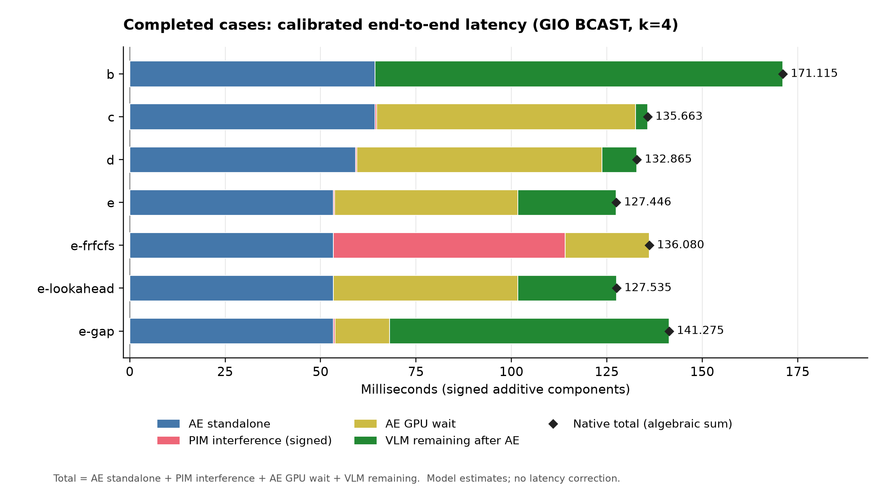

# xinyao_1109_V2：已校准的端到端并发仿真结果

本目录归档 2026-11-09（Asia/Shanghai）最新已完成结果：**7 组完整端到端配置通过独立数据审计，每组两次原生 `raw.json` 逐字节一致**。每次运行覆盖 AE **18 层 × 10 个 denoising steps** 和完整 **2357 个 VLM 工作单元（2353 kernels + 4 memcpy）**，不是单层结果乘 180。

融合后配置 **f/g 已按用户要求取消**，其部分日志只供诊断，没有有效的完整端到端结果。全 9 组汇总和完整 campaign audit 未运行；这里的 7 组独立审计不替代完整的源码、二进制、输入来源验收。取消后未重启仿真，状态见 [session](data/session.json) 和 [取消记录](data/cancellation-status.txt)。

## 来源与备份

运行基线为 `xinyao_1109-gio-bcast @ 98a66712755010d3e9e45d0c62663e0702aa13ee`，包含 BCAST 共享 rank GIO 与 `tCCD_L` 约束；正式运行源码为 **`6bcd57b073e86674f5abec24eee56ecde8252f30`**。追加修复在 GPU 候选扫描时跳过 ACT owner 阻塞的 bank，避免漏选其他可发射请求；对应回归在旧版失败、修复版通过。校准和全部结果使用同一份冻结二进制与运行库。

拉取分支前，已完整备份原重写目录 `dev0:/fact_data/xinyaowang/pim_vla_sim2_20261109`，原提交为 `660cdfcb28bdd664b2f08c94c91074e85276de53`。备份包含 Git 历史、未提交文件、构建和实验结果，保存在服务器：

```text
/fact_data/xinyaowang/backups/pim-vla-rewrite-before-gio-bcast-20261109-112224
```

`simulator.tar` SHA-256 为 `496b56992aa5a451dc981d529092e5925f06d6889bfe24554d408a4765e6bf11`；`rewrite-all-refs.bundle` 为 `a30fe1f128f3722a3d929127cebb83dd7cf4889f81ce41474b2139e0d10902af`。两份备份已校验，见 [备份哈希](data/backup-SHA256SUMS)。完整原目录备份保留在服务器，不包含在本结果包内。

## VLM 校准

先完成全量 VLM solo 校准，再冻结参数供所有并发配置共用。候选 1 是预定顺序中首个通过总时长 ±5% 门槛的候选。

| 指标 | 数值 |
|---|---:|
| 实测 phase 目标 | 104.950496 ms |
| 原生仿真校准结果 | 106.893161 ms |
| 总时长相对误差 | +1.851030% |
| kernel 相对误差中位数 | 0.343365% |
| kernel 相对误差 P90 | 8.648136% |
| α / 每通道 outstanding window | 1.0 / 1024 |
| write high / low watermark | 768 / 256 |

逐单元实测时长之和为 **105.220578 ms**，保持原值，未缩放到 phase 目标。总时长进入验收门槛，kernel 中位数和 P90 是误差诊断。α 只作用于 kernel 的 L2 写流量代理，memcpy 写量不缩放；本次 α=1，保留全部写代理流量，不能据此认定实际 DRAM 写回率已测得。原生 GPU 读/写字节分别为 **11,804,375,072 / 8,028,931,008 B**。

详见 [冻结校准](data/campaign/calibration/calibration.json)、[全部候选扫描](data/campaign/calibration/calibration-sweep.csv) 和 [校准诊断](data/calibration-diagnostics/calibration-report.md)。诊断还给出按 kernel 名称累计超时、逐 ordinal 误差、16 通道 CA/DQ 占用、ACT/PRE 和行命中统计。

## 已完成的 7 组结果

单位均为 ms；保留六位小数，精确值和原始 SHA-256 见 [结果 CSV](data/completed-seven-evaluation.csv) 与 [独立审计](data/completed-cases.json)。所有配置使用 GPU rank0 **REFpb**、PIM rank1 **REFab**。

| Case | 布局 / RoPE / 执行方式 | AE solo | PIM 阶段增量 | AE GPU 等待 | VLM 尾部 | e2e total |
|---|---|---:|---:|---:|---:|---:|
| b | feature / GPU / 串行 | 64.222010 | 0.000000 | 0.000000 | 106.893161 | **171.115172** |
| c | feature / GPU / streaming，pim_head | 64.222010 | 0.486965 | 67.813365 | 3.140553 | **135.662893** |
| d | token / GPU / streaming，pim_head | 59.147268 | 0.342188 | 64.231974 | 9.143347 | **132.864777** |
| e | token / local / streaming，pim_head | 53.312744 | 0.381497 | 47.932291 | 25.819906 | **127.446437** |
| e-frfcfs | token / local / streaming，frfcfs | 53.312744 | 60.764124 | 22.003605 | 0.000000 | **136.080473** |
| e-lookahead | token / local / streaming，pim_lookahead | 53.312744 | 0.018840 | 48.384300 | 25.819183 | **127.535066** |
| e-gap | token / local / streaming，gap_batch | 53.312744 | 0.421437 | 14.317000 | 73.223711 | **141.274892** |

已完成配置中 e 最短，相对 b 降低 **25.5201%**（**1.34264×**）；e-lookahead 比 e 多 **0.088629 ms**。f/g 缺失，因此本表不支持融合前后完整性能结论。

e 的四个版本仅替换仲裁策略：`pim_head` 保护当前依赖和资源已就绪的 PIM 请求；`frfcfs` 在可发令候选中优先行命中，再比较到达时间；`pim_lookahead` 最多前看 32 条 PIM 指令并保护预测发令时刻；`gap_batch` 按当前可见的 PIM 候选估算切换间隙，并结合读写方向批处理 GPU；没有可见 PIM 候选时允许 GPU 前进，不保证尚未知晓的后续 PIM 请求不受影响。这里 GPU/local 指 RoPE 执行位置，local 为每个 PIM bank 内的 RoPE PE，AE 仍保留其他 GPU 工作。



四个分解项的定义如下：

1. **AE solo**：对应同一布局、RoPE 和 dataflow 的完整 AE 单独运行时间，包含 PIM 阶段和保留的实测 GPU 工作。
2. **PIM 阶段增量**：逐阶段求和 `并发阶段时长 − 对应 AE solo 阶段时长`。它衡量原生阶段时长的变化，不是额外再加的一份总线耗时。
3. **AE GPU 等待**：AE 已准备执行 GPU 工作，但 GPU 被当前不可抢占的 VLM kernel 占用时的累计等待。VLM kernel 必须同时满足实测时长下限和全部访存完成条件才结束。
4. **VLM 尾部**：`原生最终完成时刻 − AE 完成时刻`，包含 AE 结束时已启动但未完成的 VLM 工作；不是剩余 kernel 的 solo 时长之和。

因此 `e2e total = AE solo + PIM 阶段增量 + AE GPU 等待 + VLM 尾部`。总时延直接取同一原生时间线上 AE 和全部 VLM 工作均完成的时刻；`VLM_memory_stall` 是诊断量，不能再次加到 total。b 定义为 AE solo 后重置 DRAM 行状态与刷新相位，再运行 VLM solo 的独立 epoch 串联。

## 并发与流水时序口径

融合前 streaming 由仲裁器调度 GPU/PIM 对共享外部 CA/DQ 的请求。融合后，staging 和输出 export 使用外部 CA/DQ；进入 descriptor 的私有 PIM 计算后，外部 CA/DQ 释放给 GPU。rank1 的 BCAST/GIO 约束保持在该 rank 内，私有命令不占外部 CA/DQ。合成原生回归验证了 staging/export 期间不新发 GPU 请求、私有窗口内 GPU 实际前进，以及私有与外部命令可在同一 CK 发射；这只验证机制，不构成 f/g 的完整端到端成绩。

命令发射、计算与 DQ 数据返回采用流水时序，不能把全部命令 latency 顺序相加。staging、export、DQ drain、刷新和 GPU 等待均保留在原生时间线上。若相邻命令的发射间隔为 `Δissue`，前后命令到 DQ 开始的延迟为 `Lprev/Lnext`，前一 burst 长度为 `Bprev`，则：

```text
DQ 净空 = Δissue + Lnext − Lprev − Bprev
```

当前 `CL=23 CK`、`CWL=12 CK`、burst 为 `2 CK`。以仅受跨 rank 切换约束的最早发射为例：**R→W 的命令间隔 15 CK 对应 DQ 净空 2 CK**（`15+12−23−2`）；**W→R 的命令间隔 2 CK 对应 DQ 净空 11 CK**（`2+23−12−2`）。这是命令域与数据域的换算，不是把时序参数由 15 改为 2 或由 2 改为 11；其他时序和资源约束可能继续增大间隔。

模型保留实测算术 helper 时间，额外 GPU↔PIM 控制 hand-off 取 **0**，PIM 搬运占用 GPU SM 的开销未建模。VLM 使用均匀请求释放、有限 outstanding 和合成顺序地址；这里是条件仿真结果，不是 Thor 并发硬件实测。

## 归档内容与当前状态

- [data/campaign](data/campaign/)：保留 campaign 除 `frozen/` 外的全部内容，包括已完成 raw/config/log/provenance、五种 AE solo、校准候选、f/g 部分日志和先前顺序运行尝试。部分输出必须结合 session 与独立审计判断，不能当作有效完成结果。
- [data/frozen-runtime.tar.gz](data/frozen-runtime.tar.gz)：无损压缩的完整 `frozen/`，包含冻结源码、生成程序、可执行文件、运行库和 SHA 清单。单份生成程序较大，使用归档存储；解压到 `data/campaign/` 可恢复原冻结结构。
- [data/completed-cases.json](data/completed-cases.json)：7 组独立审计，核对两次原始结果一致性、完整阶段/VLM 覆盖、DQ 字节、刷新策略和时间恒等式；误差容限为 0.002 μs。
- [data/calibration-diagnostics](data/calibration-diagnostics/)、[figures](figures/)、[tools](tools/) 与 [validation](validation/)：校准诊断、图表、独立审计工具和验证记录。
- [data/validation-results](data/validation-results/)：本次单层 PIM 和并发 smoke 原始输出；这些短测不能作为 f/g 完整 e2e 结果。
- [data/publication.json](data/publication.json) 与 [data/campaign-inventory.json](data/campaign-inventory.json)：发布状态、归档哈希、原始 campaign 每个文件的大小与 SHA-256。全部文件另由本目录 [SHA256SUMS](SHA256SUMS) 覆盖。

先在本目录验证提交的文件：

```bash
sha256sum -c SHA256SUMS
```

仅恢复文件、不启动仿真：

```bash
tar -xzf data/frozen-runtime.tar.gz -C data/campaign
```

配置及 provenance 中的原始服务器绝对路径作为证据原样保留。解包后可使用 `python3 tools/summarize_concurrency.py data/campaign --cases b c d e e-frfcfs e-lookahead e-gap --output /tmp/gio-seven-audit` 重新核对已完成数据；该脚本只读数据并输出审计结果，不运行仿真。

正式 campaign 位于 `dev0:/fact_data/xinyaowang/pim_vla_gio_bcast_e2e_20261109-112224/results/e2e-gio-bcast-calibrated`。当前有效范围为上述 7 组，f/g 与全 9 组验收保持未完成状态。
