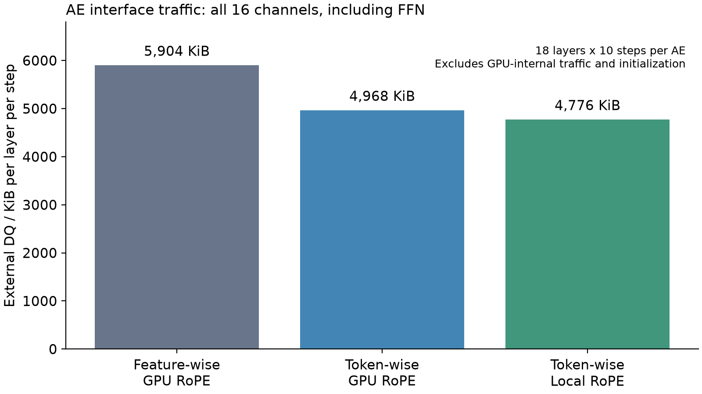
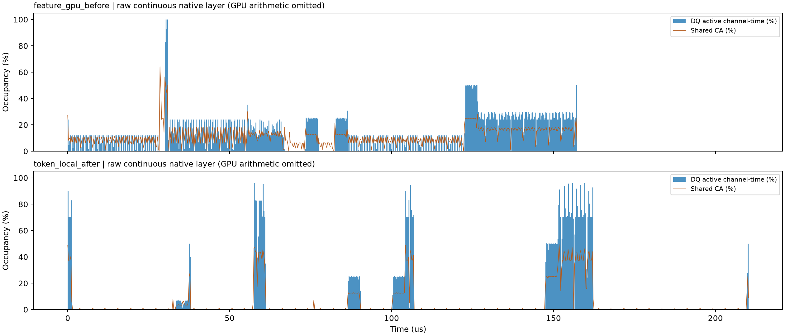
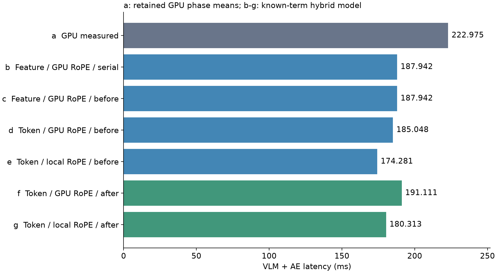

# xinyao_1108：布局、RoPE 与空闲窗口实验

完成日期：2026-11-08。原生仿真在 dev0 的 CPU Slurm 节点运行，最终 matrix job **1971246**，分析 job **1971300**，最终验证 job **1971301**。分支从 `xinyao_1107` 的 `cfe0f6a` 建立。

## 结果口径

DQ 与总线时间线来自新跑的原生 Ramulator 仿真。a 使用已有 GPU 测量；b–g 为**原生 PIM 时间 + 已有 GPU kernel 时间 + 新测边界 kernel 时间的已知项模型**，不是实际 GPU/PIM 同机并发的端到端测量。没有重跑纯 GPU 或 VLM baseline。

按指定口径计算 `T = AE + VLM − AE 期间能容纳的完整 VLM kernel 时间`。VLM kernel 严格按原执行顺序放入一个连续窗口，不能拆分、跨窗口累积或跳过前置 kernel。每个窗口要求全部 16 channel 的 DQ 和共享 CA 同时空闲。这里遵循给定的重叠核算式；它本身不证明同一输入请求的 VLM→AE 数据依赖可由真实调度器实现。

配置为 Pi-0.5、H16、18 层、10 denoising steps，8 heads、head dimension 256、hidden 1024、FFN 4096、KV 有效984/padded992。16 channels，每 channel 的 rank1 执行 PIM、rank0 留给 GPU；每 rank 16 banks。

## 1. DQ 总流量

| Layout / RoPE | 每层每步 KiB | 完整 AE MiB | 相对 feature 减少 |
| --- | --- | --- | --- |
| Feature-wise + GPU RoPE | 5904 | 1037.81250 | 0.0000% |
| Token-wise + GPU RoPE | 4968 | 873.28125 | 15.8537% |
| Token-wise + local RoPE | 4776 | 839.53125 | 19.1057% |

统计外部 PIM/GPU 接口 DQ，16 channels 合计；完整 AE 为每层每步乘以 180。包括 FFN，排除一次性权重/KV 初始化和 GPU/VLM 内部显存流量。before/after 的字节数相同，改变的是输入路径、命令和传输时机。

| 分项 / KiB 每层每步 | Feature + GPU RoPE | Token + GPU RoPE | Token + local RoPE |
|---|---:|---:|---:|
| QKV 输入 | 512 | 256 | 256 |
| GPU RoPE：Q/K 读出及写回 | 256 | 256 | 0 |
| Q 转发读出 | 0 | 0 | 64 |
| Q 转发至 peer | 0 | 64 | 64 |
| QKT score FP32 导出 | 992 | 496 | 496 |
| PV probability BF16 输入 | 496 | 248 | 248 |
| PV→O 外部传输 | 0 | 0 | 0 |
| O 部分结果导出 | 512 | 512 | 512 |
| 共用 FFN | 3136 | 3136 | 3136 |
| 合计 | 5904 | 4968 | 4776 |

GPU RoPE 后 GPU 已持有 Q，所以不重复收取 Q 转发读出；native `GPU_Q_READY` 仅作为就绪依赖。布局单独带来 **936 KiB / 15.8537%** 减少；在 token 布局上用本地 RoPE 再减少 **192 KiB / 3.8647%**；相对 feature + GPU RoPE 总计减少 **1128 KiB / 19.1057%**。



### Feature-wise 来源

采用已找到的 `outputs/attention-full-comparison/comparison.json` 和 `analyze.py` 中的 baseline；该比较基于 `xinyao_1104_O_Projection` 工作树。原始定义及来源哈希保存在 [layout-baseline-source.json](layout-baseline-source.json)，原始核算脚本保存在 [layout-baseline-analysis.py](layout-baseline-analysis.py)。该历史 feature 侧只有流量/计算量分析，没有原生 latency，本次实现并运行了对应布局。

每 head 两个 rank；每 rank 持有全部16个 query及128个 feature，feature 子集分别为 `[0:64,128:192]`、`[64:128,192:256]`，每 bank 8 features；KV 为 `[992,128]`/rank。PV 留在 rank 内接 O，最终均导出16份 `[16,1024]` O 部分和，GPU 求和。QKT 每32B K burst打包两个token，每个dot只用8条lane，未引入未实现的双dot打包吞吐提升。QKV/PV/O 的 tile、SRF、累加器约束由原生后端检查。该模型不执行真实 tensor，因此没有声称 BF16 数值正确性已验证。

## 2. 融合前后的 DQ 时间线



上：feature + GPU RoPE + before；下：token + local RoPE + after。横轴为一次连续 native layer 的时间，纵轴为全部16 channel 的占用 channel-time 百分比，分箱250ns。图展示原生内存/PIM阶段，**不包含 GPU 算术执行段**；原生 `serial_layer_control` 只用于物理总线连续性和总量对账，不当成完整 AE latency。完整 AE 的 GPU/PIM 交替时间保存在各 `*-schedule.csv`；GPU 算术段没有细粒度 DQ trace，不将其画成 DQ=0。

before 使用细命令、外部输入直接 `PIM_WR_GB` 广播、score 按 tile 流式导出。after 同时启用**输入先存 DRAM，再由本地读取广播、score 写回后集中导出、MAC_RUN/ROPE_RUN 粗命令**。PV→O 为已有的本地路径，两侧都保留，不另算免费外部传输。

融合扩大了连续 DQ 空闲区，但共享 CA 的 refresh 仍切开联合窗口。当前 nREFI=4164 CK、tCK=0.938ns，即约3.905832µs；实际最长联合窗口约3.88µs。不能把仅 DQ 空闲的长段直接当成 GPU 可运行时长，也不能把16个 channel 的空闲时间相加。

| 配置 | 联合 idle 累计 / ms（不可直接相减） | 最长单段 / µs | 可放入完整 VLM kernel 数 |
| --- | --- | --- | --- |
| Feature-wise + GPU RoPE / before | 22.822952 | 0.504644 | 0 |
| Token-wise + GPU RoPE / before | 22.835441 | 0.494326 | 0 |
| Token-wise + local RoPE / before | 23.483280 | 0.494326 | 0 |
| Token-wise + GPU RoPE / after | 32.895435 | 3.885196 | 1 |
| Token-wise + local RoPE / after | 33.678515 | 3.883320 | 1 |

[250ns 时间线数据](dq-timeline-250ns.csv)、[逐 channel 对账](bus-accounting.csv)、[完整模型分解](model-details.csv)。精确 DQ/CA 区间在 `native-bus-templates.json.gz`，逐窗口数据在 `*-joint-idle-windows.csv.gz`，均在服务器和完整数据包中保留；这些大型派生文件未纳入 Git。

## 3. Evaluation：VLM + AE

| 项 | 配置 | AE / ms | VLM / ms | 可重叠 / ms | VLM+AE / ms |
| --- | --- | --- | --- | --- | --- |
| a | 纯 GPU（已有测量） | 118.024545 | 104.950496 | 0.0000000 | 222.975041 |
| b | Feature-wise + GPU RoPE / before / serial | 82.991090 | 104.950496 | 0.0000000 | 187.941586 |
| c | Feature-wise + GPU RoPE / before / parallel | 82.991090 | 104.950496 | 0.0000000 | 187.941586 |
| d | Token-wise + GPU RoPE / before / parallel | 80.097077 | 104.950496 | 0.0000000 | 185.047573 |
| e | Token-wise + local RoPE / before / parallel | 69.330988 | 104.950496 | 0.0000000 | 174.281484 |
| f | Token-wise + GPU RoPE / after / parallel | 86.161789 | 104.950496 | 0.0010368 | 191.111248 |
| g | Token-wise + local RoPE / after / parallel | 75.363114 | 104.950496 | 0.0010368 | 180.312573 |

VLM 复用已有 ViT **26.290488ms** 加 language VLM **78.660008ms**，合计 **104.950496ms**。a 的 AE 为已有 **118.024545ms**，与 VLM 相加为 **222.975041ms**；按 VLM+AE 范围排除 other，不能与完整请求 wall time 混称同一指标。



before 放不下按序的第一个 VLM kernel（均值1.0368µs）；after 可以放入它，但紧接着的 convolution kernel 为144.5696µs，长于所有联合窗口，因此后续全部等待。f/g 只扣除 **0.0010368ms**，b/c 相同；这不是把累计 idle 都用满后的乐观估计。若额外要求 CUDA host launch API 也完整放进同一窗口，则五组的可扣除时间均为0。`*-threshold-sensitivity.csv` 同时给出0/1/2/5/10/20µs最小窗口阈值，≥5µs时全部为0。前置 memcpy/memset 若出现会占据窗口，但不计作节省的计算时间。

after 的本地 staging、score落DRAM及控制操作有成本。本组配置中，窗口虽变长，按完整 kernel 规则所得并行收益不足以抵消这些成本，因此 f/g 不优于各自 before；不据此宣称“空闲窗口优化带来端到端加速”。

### 延迟组成与边界

保留已有 cold AE ledger 的非矩阵 GPU kernel，替换 QKV、QKT、PV、O、Gate/Up、Down 等矩阵阶段；GPU RoPE 方案保留原 RoPE kernel，本地 RoPE 方案移除它。feature 的 QKT 两份 partial score 在 softmax 前先求和。所有方案计入 O partial 求和、Gate/Up 与 Down 的 FP32→BF16 转换。

仅补测四个新增边界算子，没有跑 VLM 或整轮 GPU baseline。Thor 上使用已预热代码及32MiB cache flush，主表采用 profiler 的**设备 kernel 中位数**：feature score sum 13.776µs、O sum/cast 9.824µs、Gate/Up cast 7.632µs、Down cast 2.592µs。CUDA event envelope 与 warm 数据另存 [handoff-measurements.json](gpu/handoff-measurements.json)，不把 host 调度空隙当作设备计算时间。

同一个共享 DRAM tensor 的 I/O 不能重复计时：GPU producer 已包含的 input ST、GPU consumer 已包含的 bulk score RD、GPU RoPE kernel 已包含的 Q/K RD/WR，在 AE 合成时间中扣除相应 native phase；**物理 DQ 流量及原始时间线仍完整保留**。这依赖共享分配和既有 kernel 时间适用的假设，不是测到了零拷贝调度。没有使用“字节数÷带宽”伪造 GPU kernel 时间。

尚未测量的项包括最终 rank 复制/补齐 tensor 布局对 GPU kernel 时长的影响、可见性与 fence/coherence、真实并行调度及干扰、改变调度后的 step 外 Euler/host 开销。因此 b–g 应标为 **known-term hybrid model**；需要真实实现或更完整的联合 GPU 模型才能升级为硬件端到端结果。

## 验证与复现

25个 native cases全部成功：5种组合，每种chain、PV+O、Gate/Up、Down和连续层。逐32B外部命令与 manifest 字节守恒，四阶段和与连续层一致；全部16 channel 的 DQ 和 CA 预约无重叠，区间位于运行时间范围内。未改变的 token/local/after 五个case与1107的 native cycles、DQ字节**逐项完全相同**。

最终186项 Python 验证和5项新增 native 非法输入检查通过，记录见 [unit-tests.log](validation/unit-tests.log)、[native-guards.json](validation/native-guards.json)。native 检查覆盖无export的import、重复/不完整Q import、输入行越界、缺失PV→O暂存写入。

服务器工作树：`/fact_data/xinyaowang/pim_vla_xinyao_1108_20261108`；原始trace、逐channel命令日志及native结果在 `results/evaluation-1971246/`，约1.2GiB。源文件/native库哈希和25组 manifest/summary/result保存在 [native-provenance](native-provenance/)，旧GPU源数据及哈希在 [gpu/sources.json](gpu/sources.json)。最终 native 库 SHA256 为 `14ae8626be476b3b9ef5b73acc24ee9e670726acfe75465599a96faeb16f3f96`。

```bash
# 在 dev0 工作树内；新运行必须选择不存在的输出目录。
sbatch experiments/pi05-unified-gemv/evaluation.sbatch
sbatch experiments/pi05-unified-gemv/evaluation-checks.sbatch
# analysis 放在 Slurm CPU allocation 内运行，gpu/ 保留数据不需要重测。
python experiments/pi05-unified-gemv/analyze_evaluation.py \
  --runs results/evaluation-1971246 --output reference/evaluation-1108
python experiments/pi05-unified-gemv/publish_evaluation.py \
  --output reference/evaluation-1108
```

机器可读主表：[DQ-traffic.csv](DQ-traffic.csv)、[evaluation-a-g.csv](evaluation-a-g.csv)、[summary.json](summary.json)。全精度结果以CSV/JSON为准，报告四舍五入。完整派生数据包为服务器根目录 `evaluation-1108-results.tar.gz`；压缩窗口和bus模板可由保留的原生日志重建。
