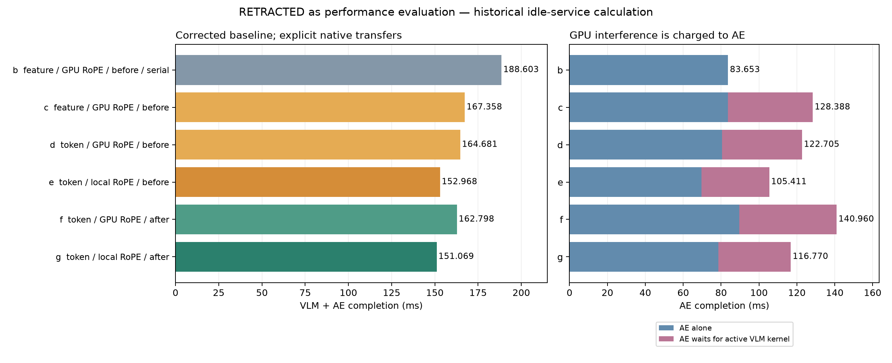
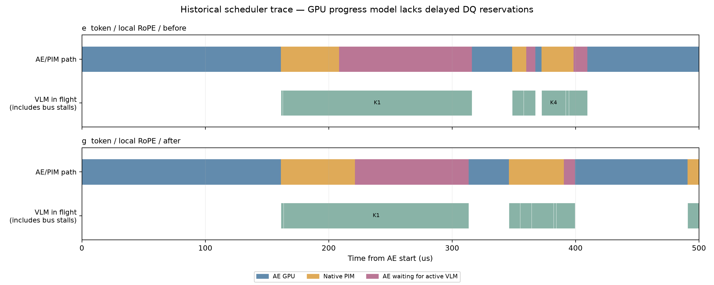

# b–g：修正基线上的跨窗口 VLM+AE 延迟

**撤回说明：以下 c–g 并行 latency、overlap 及 e/g 差值只保留为历史算法输出，不再作为有效 Evaluation。** “任何正长 DQ/CA joint idle 都贡献 GPU 进度”没有检查 CA 发出 RD 后、CL 延迟处的完整 DQ burst 是否与 PIM 冲突。数值守恒、kernel 顺序和 AE 等待检查通过，并不证明 DRAM 请求可以被调度。串行 b 及修正后的原生 PIM/DQ/CA 数据不因这一缺陷失效，其原有 I/O 计费限制仍保留。

已在 e 的实际 QKV trace（channel 0）确认反例：CK 3–4 的 CA/DQ 当前均空闲；若 CK 3 发出一个 row-hit RD，nCL=23 CK、nBL_min=2 CK 要求 CK 26–28 的 DQ，但 PIM WRGB 在 CK 25–27 已占用 DQ。该 RD 在保持 PIM 原排程时不能按 CK 3 发射。诊断见 [audit.json](../delayed-read-audit/audit.json)，逐阶段计数见 [CSV](../delayed-read-audit/independent-read-candidates.csv)。各 CK 是独立假想候选，不是实际 GPU 请求序列；通过该检查也不代表满足 ACT/PRE、bank/rank、读写转向及控制器准入约束。

后续必须联合检查命令时段与未来数据 burst，按依赖推进 kernel；不能把当前 joint idle 面积直接当作 GPU 计算量，也不能改用任意窗口阈值或恢复整 kernel 单窗口限制。CA 与 DQ 可以分处两个不同空隙，二者之间不必整段同时空闲。以下为撤回前的完整记录。

**按用户确认的调度近似完成重算。没有使用 ρ、在途请求数、读写比，也没有整 kernel 单窗口容纳限制。** 主表保留全部原生传输时间。e 为 **152.968124 ms**，g 为 **151.069018 ms**，g 减少 **1.899106 ms（1.242%）**。这是给定窗口推进规则的计算结果，不是硬件端到端测量或逐请求仲裁仿真。

原生输入来自最终正确作业 **1971385**；本次重放作业 **1971514**。before 的 b/c/d/e 没有 rank controller、没有输入 DRAM 暂存，计算期间通过 WRGB 持续补给输入；f/g 包含 DRAM 暂存、本地读取、rank controller 和粗命令。a 和已有 VLM 不重跑。

## 主表

VLM 固定沿用已有 ViT + language 测量：**104.950496035 ms**。单位全部为 ms。

| 项 | 配置 | AE 独立执行 | 等待在途 VLM kernel | 含干扰的 AE 完成 | PIM 期间 VLM 推进 S | VLM+AE 总完成 |
|---|---|---:|---:|---:|---:|---:|
| b | feature + GPU RoPE，融合前串行 | 83.652717 | 0.000000 | 83.652717 | 0.000000 | 188.603213 |
| c | feature + GPU RoPE，融合前并行 | 83.652717 | 44.735744 | 128.388460 | 21.244800 | 167.358413 |
| d | token + GPU RoPE，融合前并行 | 80.560030 | 42.145172 | 122.705202 | 20.829290 | 164.681236 |
| e | token + 本地 RoPE，融合前并行 | 69.601463 | 35.809545 | 105.411009 | 21.583836 | 152.968124 |
| f | token + GPU RoPE，融合后并行 | 89.602094 | 51.357921 | 140.960014 | 31.754419 | 162.798170 |
| g | token + 本地 RoPE，融合后并行 | 78.600304 | 38.169940 | 116.770244 | 32.481782 | 151.069018 |

“AE 独立执行”由 18 层 × 10 步原生阶段与保留的 GPU kernel ledger 拼接，不是实机 AE 墙钟时延。b 为串行，因此没有 VLM overlap 或 AE 等待。

## 调度与计费

保留 VLM 的 2357 个有序 work units（2353 个 kernel、4 个已有 copy），不越过前驱。第一次出现正长可用窗口就启动当前 work unit；不要求整个 kernel 放进窗口，不设置最小窗口长度。PIM 期间，仅在全部 16 channel 的外部 DQ/CA 同时空闲、且 GPU rank 0 未处于刷新阻塞时，按原 kernel 速度累计有效进度。占用期间保留当前 kernel 的剩余工作，下一窗口继续。

遇到 AE GPU 操作，如果当前 VLM kernel 尚未完成，先完成其剩余部分，再执行 AE GPU 操作；AE 连续 GPU 操作之间不插入新的 VLM kernel。PIM 片段结束但后续仍是 PIM 时，不强制排空 VLM kernel。AE 的源 kernel 序号和 VLM 顺序均检查单调；所有实际开始时间随等待顺延。

设 AE 独立时间为 A，VLM 独立时间为 V，PIM 期间推进为 S，AE 因在途 VLM 而等待为 W，则：

`AE_with_interference = A + W`

`VLM_progress_during_AE = S + W`

`T = (A + W) + V − (S + W) = A + V − S`

W 已计入 AE 完成时间，同时这段等待也实际推进 VLM，不能在上述总延迟上再加一次 W。本次所有并行组的 VLM 在 AE 完成时仍未结束，正长窗口均被利用；因此顺序和尾部等待改变 AE 完成位置，但在本次规则下，总完成时间满足上式。逐 kernel 的跨窗口记录、逐 AE 阻塞记录与移动后的完整时间线均保存为 CSV。

e：`105.411009 + 104.950496 − 57.393381 = 152.968124`。

g：`116.770244 + 104.950496 − 70.651722 = 151.069018`。

绿色条表示 kernel 在途区间，**包含被总线阻塞的时间**，不能把整条长度视为有效 GPU 工作量。

## e/g 为什么仍有较多抵消

g 比 e 的独立 AE 时间增加 8.998841 ms；PIM 期间 VLM 可推进量增加 10.897947 ms，因此总延迟净减少 1.899106 ms。该近似允许 before 的每个细碎空隙以零恢复成本贡献有效 GPU 进度，所以它没有量化碎片化导致的真实请求停顿、带宽效率和指令恢复成本。不能据此断言真实硬件上 g 仅改善这么多，也不能人为把 e 的 CA/DQ 改为全时占满来得到期望的差距。

## 传输口径与新增 GPU 边界

主表完整保留 native 的 GPU RoPE 导出/导入、after 输入 DRAM 写入和 score 读取阶段，避免把实际阶段静默设为零。既有 GPU kernel 时长自身也包含其访存，边界共享张量的读写可能部分重复计费。为与旧口径可比，另给出此前“同一 tensor 的 ST/RD 归属 GPU producer/consumer、从 native latency 去重”的独立附表；物理原始流量不会随去重改变：

| 项 | 主表：原生传输全部保留 | 共享张量 I/O 去重附表 |
|---|---:|---:|
| b | 188.603213 | 188.407189 |
| c | 167.358413 | 167.175391 |
| d | 164.681236 | 164.505305 |
| e | 152.968124 | 152.968124 |
| f | 162.798170 | 159.981391 |
| g | 151.069018 | 148.436444 |

两表是明确的计费选择，不是统计置信区间，也不保证包住真实硬件延迟。主表与附表不得混列比较。

修正 before 的 PV→O 路径需先将 PV 结果导出 GPU，再按 O 输入顺序广播两次。本次提供显式 GPU `transpose(0,1).contiguous()` 实现，将 query/feature-packet 顺序互换、保持 channel 和 BF16 lane，生成的缓冲供两次 O 扫描复用。Thor 实测 feature 为 **4.352000 µs**，token 为 **4.992000 µs**，每层每步一次；在 PV 导出完成与第一个 O 广播之间插入独立 GPU 依赖节点。该显式重排实现不代表所有驱动必然需要一次 copy。保留已有 O 求和及 Gate/Up、Down 类型转换测量。

新测量仅涉及这两个边界算子。每项 60 次 device-kernel profiling，使用与已有 supplemental handoff 相同的 32 MiB 清缓存流程，取中位数，并检查全部元素的重排正确性。不是重新运行纯 GPU 或 VLM baseline。

## 来源与验证

VLM 仍使用已有 phase mean；原始 prefix/setup 有序 trace 总和为 105.2205782 ms，统一乘 **0.997433181132** 使总服务量匹配 104.950496035 ms。这个比例仅用于对齐两次既有计时口径，不生成访存量。未归一化结果单列在 [profile-duration-check.csv](profile-duration-check.csv)。原 trace 未单独标记严格 VLM-only kernel 区间，因此该对应关系仍是现有 profiling 的限制。

刷新掩码来自同一次 native CA 日志：REFab 外部 CA 命令与目标 rank 的 nRFC 阻塞分开处理。只有 rank 0 的刷新额外阻塞 GPU；rank 1 的内部刷新不直接全程占据外部 CA。nRFC 为 224 CK，tCK 为 0.938 ns。

8 个调度行为测试覆盖：短窗口累计、长 kernel 阻塞后续 AE、禁止后发短 kernel 超越、连续 PIM 片段继续执行、无窗口不发射、VLM 提前完成、极短正窗口和最终 PIM 尾部。20 个原生阶段 × 2 种 I/O 口径的重放检查已通过，核对物理时间守恒、GPU 顺序、等待与工作量守恒；native 原始配置/流量已有 [修正基线校验](../direct-before-corrected/checks.json)。

该模型固定 PIM 优先级并复用独立原生阶段，GPU 不反过来改变 PIM 命令排程；插入 GPU 操作后的全局 refresh 相位不重新仿真。没有模拟 host launch gap、上下文切换或真实地址请求。由于这些限制，本表明确作为用户选定规则下的**窗口推进近似**，不恢复已撤回的合成请求结果。

另用独立区间积分程序复核保存结果：从原始可用窗口与每个 kernel 的实际在途区间取交集，逐项核对有效推进量、尾部等待、AE GPU 与 VLM 不重叠和 7 个代码/输入哈希。10 组重放均通过，见 [独立核验](independent-audit.json)。

主要数据：[主表](evaluation-b-g.csv)、[I/O 附表](shared-tensor-io-accounting.csv)、[模型与哈希](summary.json)、[测试记录](unit-tests.log)、[校验](checks.json)。所有新结果保存在 dev0：`/fact_data/xinyaowang/pim_vla_xinyao_1108_20261108/reference/evaluation-1108/corrected-overlap`。

复现：在服务器仓库根目录提交 `sbatch experiments/pi05-unified-gemv/corrected-overlap.sbatch`；绘图和报告运行 `python experiments/pi05-unified-gemv/publish_corrected_overlap.py --output reference/evaluation-1108/corrected-overlap --job <job-id>`。
