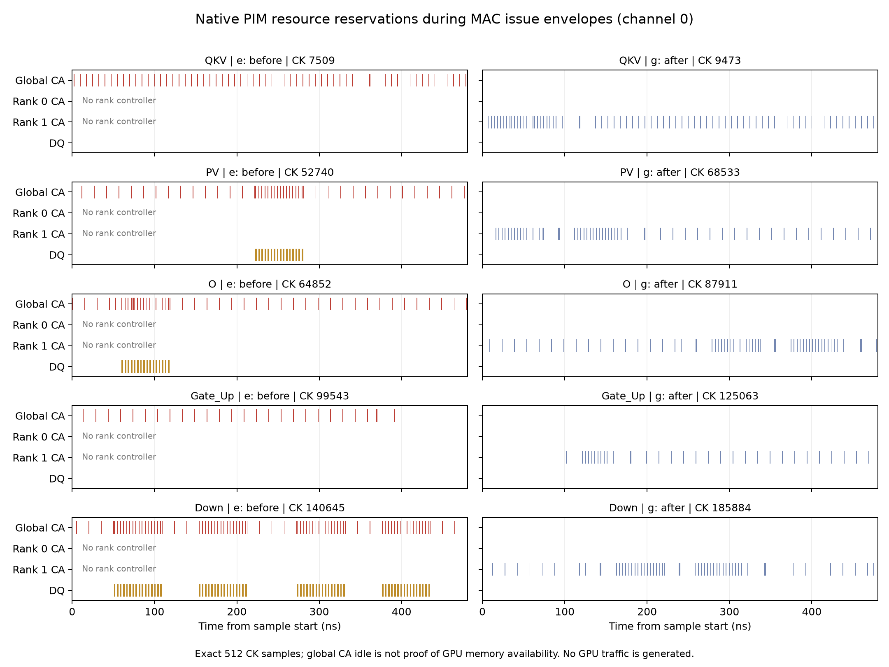
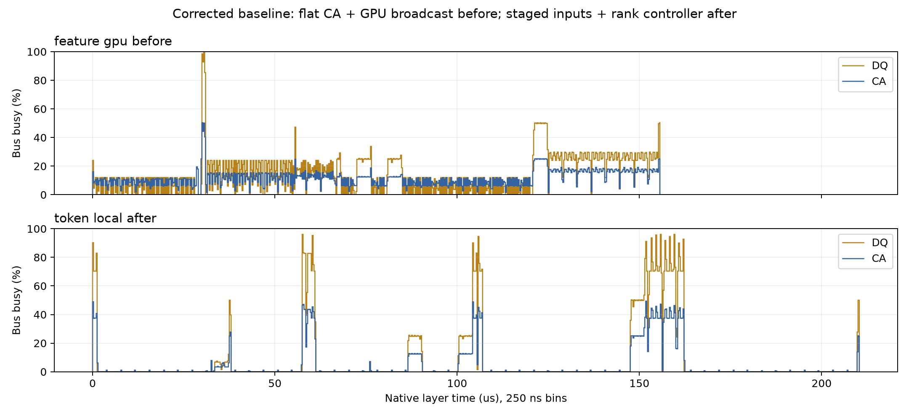
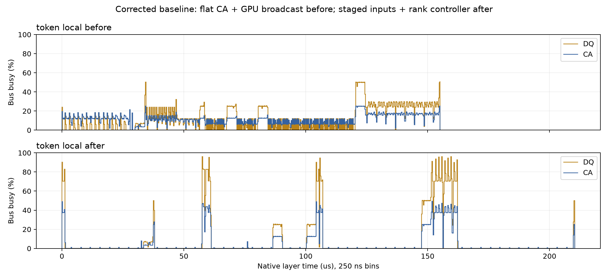

# xinyao_1108：无 rank controller 的融合前基线修正

后续已补测显式 PV→O GPU 重排，并按用户确认的跨窗口规则重算 b–g，见[延迟重算报告](../corrected-overlap/REPORT.zh-CN.md)。以下保留本次原生基线修正的记录；“尚未测量/未计算”描述的是本报告阶段。

**用户定义：融合前没有 rank controller。PIM 计算需要持续从 GPU 分批广播补充输入，占外部 DQ 和 CA；融合后才采用 DRAM 暂存、本地读取、rank controller 与粗命令。** 本次据此纠正三个 before 配置，并撤回此前误配置得到的 before DQ/CA 及 e/g 并行延迟结论。

最终原生作业 **1971385**，分析作业 **1971386**、最终检查作业 **1971396**。共5种配置×5个case；a与已有VLM测量没有重跑。本报告仅给出原生时序和流量，不使用ρ、GPU在途数或读写比例，不计算新的c–g并行延迟。

| 设置 | before：b/c/d/e对应原生基线 | after：f/g |
|---|---|---|
| rank controller / 私有rank CA | 无 / 无 | 有 / 有 |
| 输入DRAM暂存 | 无 | 有 |
| 输入来源 | GPU逐fragment通过WRGB广播；DQ占用完整计入 | 输入先写DRAM，随后本地读取 |
| 计算命令 | 原生细命令在共享外部CA发射 | 外部MAC_RUN/ROPE_RUN，内部执行 |
| PV→O | PV BF16结果导出GPU，两次O输入扫描均重新广播 | PV结果本地写入并从DRAM读取 |

SRF仍是每bank的1 KiB输入缓冲；它不是rank controller。`pim_input_broadcast=false`指不做跨rank广播，并不关闭WRGB向同一PIM rank的16个bank广播。输入随fragment重复补给；“持续广播”表示贯穿算子的数据供给路径，不把有计算复用的物理总线强行标成100%忙。RoPE的bank计算单元也不等于rank controller。

## 修正后的原生DQ总量

| 配置 | KiB/层/步，全部16 channels | MiB/AE（×180） | 四个独立原生阶段和 / µs |
|---|---:|---:|---:|
| feature_gpu_before | 6096 | 1071.562500 | 155.260574 |
| token_gpu_before | 5352 | 940.781250 | 151.214980 |
| token_local_before | 5160 | 907.031250 | 155.090796 |
| token_gpu_after | 4968 | 873.281250 | 206.440668 |
| token_local_after | 4776 | 839.531250 | 210.076356 |

布局比较采用三个before配置：feature+GPU RoPE为6096 KiB，token+GPU RoPE为5352 KiB，token+本地RoPE为5160 KiB。相对feature基线分别减少744 KiB（12.204724%）、936 KiB（15.354331%）。本地RoPE相对同布局GPU RoPE减少192 KiB。以上包括FFN和O输入输出，不包括GPU/VLM自己的显存流量、一次性权重/KV初始化。

此前5904/4968/4776 KiB的before数值漏掉了本应经GPU中转的PV→O路径。修正后feature增加192 KiB、token增加384 KiB，分别对应PV结果导出一次和O输入扫描两次。after仍为4968/4776 KiB。本次所有after的原生timeline和CA事件文件与job1971246逐字节一致。

四阶段和及连续层时序均是PIM/内存原生运行，不能称为VLM+AE或完整AE latency。PV→O经GPU的重排、调度和实际GPU算术时长未新增测量，未当作零；它们不能从DQ字节数直接推算。

## e/g计算区间内的CA与DQ

通过barrier定位算子，再取首MAC到末MAC发射后1 CK的包络；不包括最后MAC服务尾部。下面是channel 0，其余channel数据在CSV中。O的两tile和夹在中间的导出单独保留，不用不等价区间强行比较。

| 算子 | e：外部CA忙时 | e：DQ忙时 | g：外部CA忙时 | g：DQ忙时 |
|---|---:|---:|---:|---:|
| QKV | 12.6244% | 3.2509% | 0.06669% | 0.0000% |
| PV | 9.8912% | 9.2624% | 0.07351% | 0.0000% |
| Gate_Up | 8.2706% | 5.1681% | 0.06978% | 0.0000% |
| Down | 16.0737% | 25.2556% | 0.06542% | 0.0000% |

before的CA日志只有global行，逐条对应native发射命令；没有私有rank CA，也没有提前塞入rank controller队列的外部描述符。原模型中LOCALRD/LOCALWR作为bank内部端口事件，不单独占外部CA，其ACT/PRE等前置命令仍使用共享CA；该既有命令定义未改成额外硬件协议假设。

## DQ与CA时间线

原始要求的feature+GPU RoPE融合前与token+本地RoPE融合后：

同layout、本地RoPE的e/g对照：

横轴来自各自一次连续native layer，250 ns分箱；不把未记录的GPU算术段画成DQ空闲。原始逐channel对账见[bus-accounting.csv](bus-accounting.csv)，细粒度统计见[逐算子CSV](linear-ca/per-operator-ca.csv)。

## 校验和范围

所有before均检查rank_controller=false、rank_staging=false、stream_inputs=true，无STAGE/PV_SPILL/O_REWIND或粗命令。每个线性MAC阶段均含GPU WRGB，输入覆盖、输出依赖、SRF容量与MAC顺序仍由原生模型检查。全部25个case的DQ字节守恒，CA/DQ各自不重叠；before的240个CA日志逐条对应flat native命令；after的320个timeline/CA日志与旧正确after逐字节一致。另有[单元测试](unit-tests.log)、[故障注入检查](native-guards.json)和[汇总](checks.json)。

原始数据在dev0 `/fact_data/xinyaowang/pim_vla_xinyao_1108_20261108/results/evaluation-1971385`；原生库SHA256为`5cdc451ff5dbc3f69a6fd030c273653c2fa9d5c9f0b3328b83e76bed01ec0ba6`。来源源码、配置、trace哈希及barrier均归档于[native-provenance](native-provenance/provenance.json)。中途job1971378在新增feature PV外部导出路径暴露8列打包除零，已修复；1971380因补齐显式配置/输入路径metadata而终止，以最终完整作业为准。

**此前“e/g几乎等延迟”结论撤回。正确基线的资源供给条件现在已经记录；VLM可推进多少仍需要有依据的GPU访存与计算依赖，不能沿用旧合成请求模型。**
