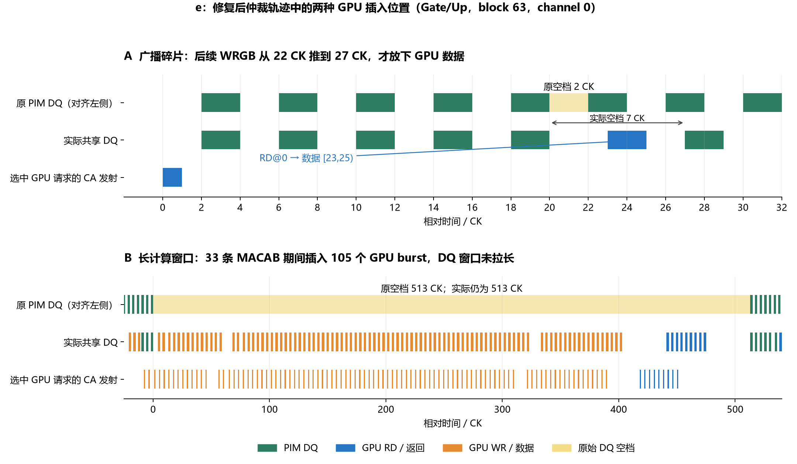

# e：GPU 访存究竟插入哪些 DQ 空档

作业 `1974893` 对修复后的 `token_local_before` 做只读插桩：900 个 PIM 阶段、16 个 channel。所有阶段、VLM placement、总延迟与 job `1974571` 一致；插桩不改变仲裁决策。

按 GPU 数据真正占用 DQ 的时刻统计。RD/WR 在 CA 上发射，数据分别在 23/12 CK 后返回；不能把命令发射位置当作 DQ 数据位置。

| 原始 DQ 空档 | GPU burst 数（16 通道合计） | PIM 期间占比 | 典型位置 |
|---|---:|---:|---|
| 2 CK | 15,883,421 | 21.29% | WRGB 广播之间、RDRES 导出之间；需要扩展空档 |
| 3–16 CK | 4,233,706 | 5.67% | 主要是 RDRES→RDRES 的 6 CK 间隔 |
| 17–64 CK | 4,395,446 | 5.89% | Down 的 48 CK、普通 RD 间隔等 |
| 65–256 CK | 6,415,587 | 8.60% | Down 的 65 CK、PV 的 240 CK 等 |
| >256 CK | 43,470,420 | 58.27% | Gate/Up、O 的 496/513 CK，chain 的 1380 CK 等 |
| 阶段末尾 | 208,980 | 0.28% | 最后一笔 PIM DQ 之后、16 个 channel 均完成之前 |

分母为 PIM 尚未结束期间的 74,607,560 个完整 burst，均为 32 B / 2 CK。每个实际 PIM DQ 间隔关联回相邻两笔原生 PIM burst，以原生间隔长度分类。阶段完成取 16 个 channel 中最晚完成；该完成点只供统计使用，不参与仲裁。

2 CK 对应位置的 15,883,421 个 GPU burst 中，11,941,274 个来自 WRGB→WRGB，3,940,231 个来自 RDRES→RDRES，1,916 个来自 RDRES→WRGB；没有一个能按本次实际落点与 DQ 保护间隔装进原来的 2 CK 长度。

图 A：Gate/Up、block63、channel0。以选中 GPU RD 的发射为 0，前一 WRGB 数据为 [18,20)，原下一 WRGB 为 [22,24)。GPU 数据在 [23,25) 返回，下一 WRGB 改为 [27,29)，原 2 CK 间隔扩成 7 CK。这段相邻 PIM 数据之间增加 5 CK。

图 B：同一阶段的另一处 513 CK 原始间隔含 33 条 MACAB；105 个 GPU burst 插入后，该段仍为 513 CK。原有计算窗口确实能容纳 GPU 访存，并非所有插入都依赖延长 PIM。

按“对齐左侧实际 PIM endpoint，恢复原间隔长度，再检查当前 GPU burst 与 DQ 保护间隔”的几何检查，65.26% 的 PIM 期间 burst 能装进原长度。该检查只说明 DQ 位置，不证明零 CA、row、依赖或 GPU 执行资源代价。

## 跨 PIM 边界的 kernel 尾巴

已启动 VLM 前缀一共有 312,053,120 个 burst：PIM 结束前完整落下 74,607,560 个；结束后 237,443,252 个（76.09%）；跨边界 2,308 个。后者不能算作利用 PIM 空闲。模型已计入 AE GPU wait 75.419926 ms。PIM 等待为 6.871574 ms，归一化总延迟为 131.639969 ms。

## 数据与复现

- [全量统计与口径](summary.json)
- [按算子、原始空档长度、两端命令细分](gap-length-and-endpoints.csv)
- [按算子与长度区间汇总](insertion-by-stage.csv)
- [原生窗口内的命令来源](native-gap-origins.json)
- [两个示例的精确 tick、CA 与 DQ](verified-examples.json)
- [chain trace](block-41-ch0-trace.csv)、[PV trace](block-46-ch0-trace.csv)、[O trace](block-48-ch0-trace.csv)、[Gate/Up trace](block-63-ch0-trace.csv)、[Down trace](block-67-ch0-trace.csv)

表格覆盖所有阶段和通道；逐命令 CSV 只保存每类首个阶段的 channel0，避免把样本 trace 误当成全量。时间单位为模型整数 tick：1 CK=15008 ticks，1 µs=16000000 ticks，1 CK=0.938 ns。`native_issue` 为阶段内原生 PIM 发射点；GPU 的该字段为 -1；`dq_a/dq_b` 为半开区间，-1 表示无外部 DQ。

执行仓库根目录的 `python3 experiments/pi05-unified-gemv/run_arbitrator.py --output outputs/arbitrator --cases e --audit-e`。这是模型轨迹，尚未加入 GPU mover kernel/SM/cache 资源竞争。
