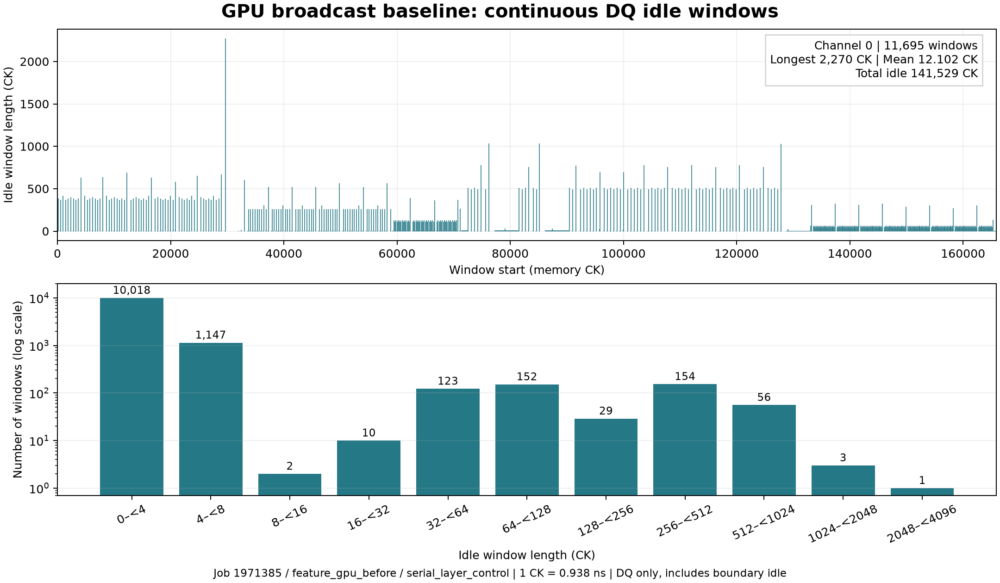

# 融合前 GPU 广播基线：DQ 连续空闲窗口

来源为原生 job1971385，`feature_gpu_before/serial_layer_control`。没有 rank controller 和输入 DRAM 暂存，输入由 GPU 经 WRGB 广播；尚未叠加 VLM 仲裁流量。

16 个 channel 的空闲区间序列完全相同。每个 channel 共 165,913 CK，DQ busy 24,384 CK，idle 141,529 CK；共有 11,695 段正长最大连续空闲（含首尾边界），最长 2,270 CK，平均 12.101667 CK，中位数 2 CK。共有 10,007 段恰为 2 CK。

- [统计口径与来源校验](summary.json)
- [channel0 每段起止和长度](idle-windows-ch0.csv)
- [全部通道 CSV，gzip 压缩](idle-windows-all-channels.csv.gz)
- [按窗口长度分布](window-length-distribution-ch0.csv)
- [最长20段](longest-20-windows-ch0.csv)

窗口是 DQ burst 区间的补集，不按 CA 或语义阶段切碎。CK 取原生 frontend tick/32，首尾可以是分数 CK。DQ 空闲不代表 CA、阵列或 GPU 可立即执行；本表不能直接累加为 GPU 可用执行时间。

复现脚本为 `experiments/pi05-unified-gemv/arbitrator-audit/analyze_broadcast_idle.py`，读取本目录 `native/` 的 16 份原始 trace，并核对原生 provenance、DQ 总量与已发布 utilization 分桶。
