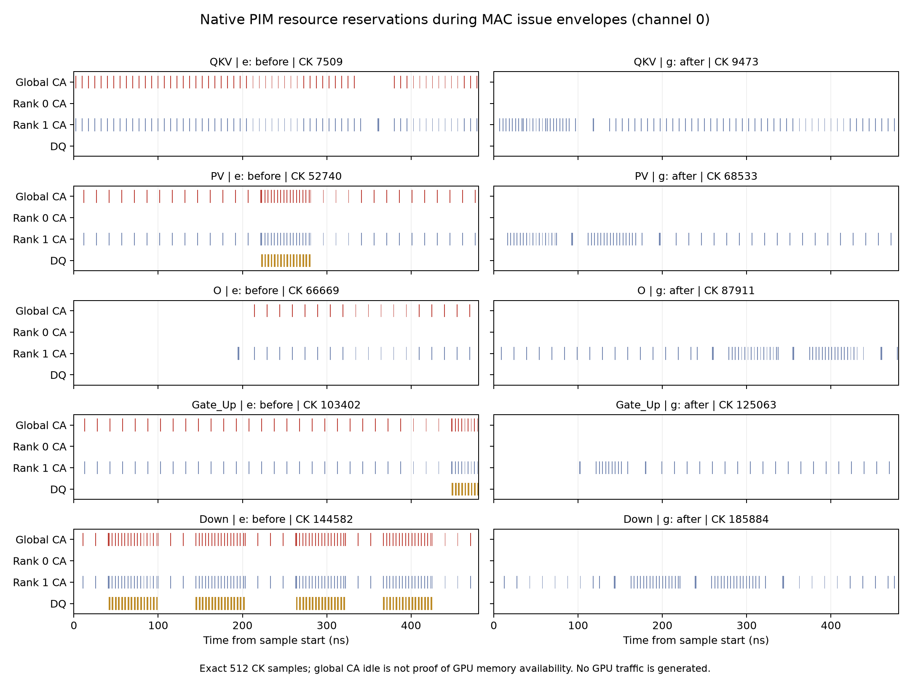

# 线性算子期间的共享 CA：e / g 原生 trace 复核

日期：2026-11-08。读取 dev0 原生 job1971246 的两组 `serial_layer_control`，逐个检查全部16个channel；没有重新生成GPU请求，也没有使用ρ、在途请求数或读写比例。**旧参数化请求模型的 c–g 延迟不再用于 Evaluation 或推断融合收益。**

结论：细命令版在计算期间持续、反复向共享CA发令，粗命令版将这些命令移入rank内执行，外部CA只剩少量维护。e 的空隙以数个CK为主，g出现微秒级长空隙。共享CA忙时会挡住同channel的GPU命令；GPU依赖尚未返回的数据时也会停顿。原始trace能证明资源冲突和窗口形态，不能独自给出GPU停顿时长或新的e/g端到端延迟。

## 统计范围

用manifest和barrier定位QKV、PV、O、Gate/Up、Down，再保留两种范围：完整语义phase，以及该phase内“第一条MAC发射到最后一条MAC发射后1 CK”的包络。下面使用后者，排除首MAC之前的初始装载和最后MAC之后的导出；不把最后MAC的服务尾部算入。包络内部仍包含输入补充、刷新和计算等待。

全部16个channel在下表范围内得到相同结果；1 CK=0.938 ns。占用来自 `scope=global` 的真实区间，不能把rank内部命令重复加到外部CA上。

| 算子 | e：外部CA占用率 | e：典型CA空隙 | g：外部CA占用率 | g：最长CA连续空隙 |
|---|---:|---|---:|---:|
| QKV | 11.9912% | 7 CK（6.566 ns） | 0.06669% | 3.882382 µs |
| PV | 9.3223% | 3 / 15 CK（2.814 / 14.070 ns） | 0.07351% | 3.882382 µs |
| Gate/Up | 7.8837% | 15 / 3 CK（14.070 / 2.814 ns） | 0.06978% | 3.882382 µs |
| Down | 15.7911% | 3 / 15 CK（2.814 / 14.070 ns） | 0.06542% | 3.897390 µs |

“典型”指最常出现的空隙长度，不是按时间加权的占比。g也存在维护命令之间的短空隙，不能用不加权中位数代表其主要长窗口。g上述包络内DQ为0占用；e的Down包络内DQ忙时占25.2658%，同时扣除DQ和CA后，最常见空隙为2 CK（1.876 ns，3806段），其次15 CK（885段）。这些是物理预约空隙，不是实测GPU可用服务时间。

O有两次tile计算。e两段MAC包络的外部CA占比分别为4.8026%、4.7119%，典型空隙15 CK；g单条O_RUN覆盖两tile，第一条到最后一条MAC之间还夹有第一次输出，整个包络CA为2.0821%、DQ为4.0228%。不将这个含中间输出的g值与e单tile纯计算值作无条件比较。逐phase、逐channel以及global/rank/DQ区间数据保存在[CSV](per-operator-ca.csv)和[JSON](audit.json)。



图中每个片段为对应MAC包络1/4位置开始的512 CK原始记录，未选择“最有利”时刻。横轴为相对时间；标题保留原始CK位置。左右对应不同执行时序，不把相对时刻解释成相同MAC序号。rank内部CA仍忙，而g的外部CA在这些片段中为空，正是粗命令的作用。

## 与之前CA图的关系

之前的[粗细命令报告](../../commands-1107/REPORT.zh-CN.md)已明确展示：同一段183.3–187.8 µs的Down计算期间，细命令版发出120条外部CA命令，其中114条为计算控制、6条为维护；粗命令版仅5条维护。两组该段DQ都空闲，粗命令版出现3.897 µs连续共享CA空隙。来源是该报告的[绘图证据](../../commands-1107/readable/plot-evidence.json)。

这组历史对照固定两bank输入暂存，只改变粗细命令接口；当前e/g还同时改变直接输入与DRAM暂存路径，因此不能把旧before直接当作当前e。两组证据均说明：输入存入DRAM只释放DQ，粗命令进一步释放外部CA。

## 为什么不能据此说“e不会阻塞GPU”

1. GPU命令与PIM外部命令竞争同channel CA；CA忙时必须等待或改变PIM调度。空闲占比高，不等于GPU能持续保持单独运行时的访存供给。
2. e计算中的CA空隙只有数个CK且反复被切断。不能把它们加成一个大窗口，也不能把kernel计算时钟视为无条件继续推进。
3. 同样不能因为空隙短，就断言任何GPU请求都放不进去。DRAM发令与数据返回发生在不同时刻，不要求完整读延迟放进同一空隙；本分析不恢复“整kernel放进单个窗口”的限制。
4. 原生控制器的普通访问还检查目标rank CA及bank时序。访问PIM所在rank/bank会有额外冲突；访问另一个rank则不同。旧重放固定GPU访问rank0，未重建真实地址分布，并忽略rank CA和bank状态，因此不能外推到任意GPU访存。
5. g释放的是外部CA与DQ。PIM仍使用目标rank的内部CA和数组；g也不是无条件、无干扰的全速GPU执行窗口。

源码证据：[两级CA准入](../../../experiments/pi05-bgk-gpuq/backend/ramulator2/src/ramulator/controller/impl/rank_staging_extension.inc)、[细命令派发](../../../experiments/pi05-bgk-gpuq/backend/ramulator2/src/ramulator/controller/impl/lpddr5_controller.cpp)、[MAC与普通RD/WR的bank时序](../../../experiments/pi05-bgk-gpuq/backend/ramulator2/python/ramulator/dram/lpddr5pim.py)。旧[请求重放](../../../experiments/pi05-unified-gemv/request_replay.cpp)还将kernel完成时间近似为原始完成时刻与最后请求完成时刻的最大值，没有kernel内部访存—计算依赖。故e/g接近共同GPU工作量下限不是粗命令无收益的证据。

## 复现与核验

服务器原始目录：`/fact_data/xinyaowang/pim_vla_xinyao_1108_20261108/results/evaluation-1971246/{token_local_before,token_local_after}/serial_layer_control`。分析脚本：[audit_linear_ca.py](../../../experiments/pi05-unified-gemv/audit_linear_ca.py)。

```text
python experiments/pi05-unified-gemv/audit_linear_ca.py --input results/evaluation-1971246 --output results/linear-ca-audit --no-plot
```

输出绑定每个输入文件的SHA256。核验CA事件无重叠、DQ区间无重叠、每段busy+idle=区间长度、两组MAC数量一致、16个channel结果一致，以及与已归档metadata、总线占用及服务器原始CA文件一致；见[checks.json](checks.json)。没有重新模拟AE或GPU，没有产生替代c–g延迟点估计。
