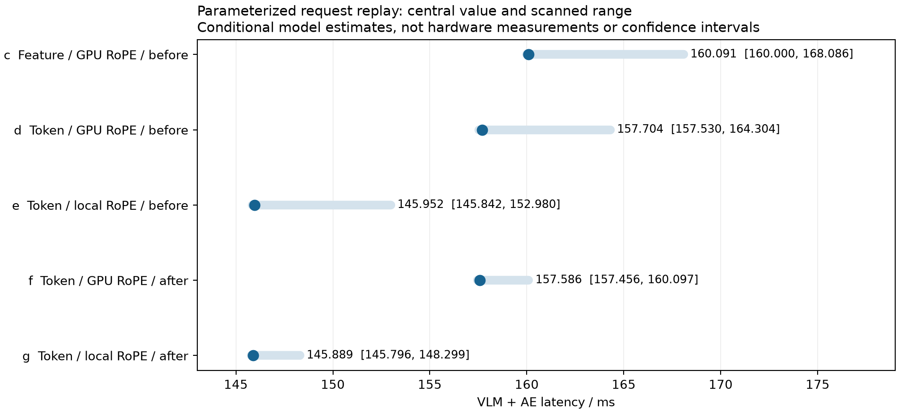
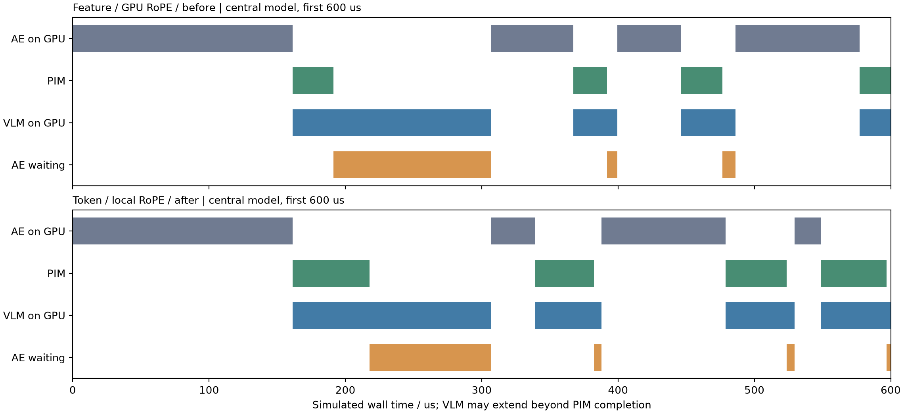

# xinyao_1108：允许 kernel 跨窗口推进的参数化请求仲裁

日期：2026-11-08。取消整kernel装入单窗口的限制后，曾进行了参数化请求重放。最终运行job **1971324**；复用native job1971246及已有GPU/VLM测量，没有重测纯GPU或VLM baseline。本报告保留请求级重放的探索性结果；最终并行Evaluation仍需校准。原始DQ流量与native时间线不变。

**c–g是条件性模型估计，不是采集到的真实GPU访存trace或硬件端到端测量。扫描范围也不是置信区间或真实性能上下界。** 原有Nsys记录只有kernel顺序和时长；cold AE NCU记录没有DRAM请求量；既有Thor探测未暴露DRAM读写计数器。没有将L2流量冒充DRAM流量。

**再次审查：停止使用ρ、在途数、读写比的合成假设推断性能；以下c–g数值仅为旧模型归档，不再用于Evaluation或比较e/g。** 新的[逐线性算子CA审计](../linear-ca-audit/REPORT.zh-CN.md)显示，QKV/Gate-Up/Down计算期间共享CA从11.99%/7.88%/15.79%降到约0.07%，典型空隙从数个CK变为微秒级长窗口。旧重放还缺少目标rank CA/bank时序及kernel内部访存依赖。下面的整层平均值不能用于说明GPU不受阻塞。

**前次审查记录：** ρ=0.30、32个在途请求和80/20读写比都不是Pi-0.5测量值。当前e的channel0共享CA忙时18.484228µs/158.746182µs=11.644%，g为9.587298µs/210.341810µs=4.558%；e并未被建模为算子执行期间外部CA持续独占。e的每条外部细命令一般计1CK，部分底层操作由rank控制器在私有CA上执行。必须按实际接口核对所有外部命令及发送频率，不能将细粒度直接等同于100%外部CA占用。

当前kernel模型没有内部数据到达后才能继续计算的依赖。中间配置的e/g结果恰好等于共同GPU串行服务时间145.737056ms分别加0.214865/0.152260ms额外访存延迟，说明两者PIM时间在这套模型中几乎完全被隐藏。这个现象不能证明真实硬件中e/g等效。参数扫描及资源冲突测试通过，也不等于这些建模假设被实测验证。

## 探索性a–g结果（暂不用于最终Evaluation）

| 项 | 配置 | VLM+AE / ms | 来源 |
| --- | --- | --- | --- |
| a | 纯 GPU | 222.975041 | 已有 GPU 测量 |
| b | Feature / GPU RoPE / before / serial | 187.941586 | 已有串行已知项模型 |
| c | Feature / GPU RoPE / before | 160.091144 | 本次参数化请求模型 |
| d | Token / GPU RoPE / before | 157.704393 | 本次参数化请求模型 |
| e | Token / local RoPE / before | 145.951921 | 本次参数化请求模型 |
| f | Token / GPU RoPE / after | 157.585659 | 本次参数化请求模型 |
| g | Token / local RoPE / after | 145.889316 | 本次参数化请求模型 |

中间配置采用请求压力ρ=0.30、每channel最多32个在途请求、读写80/20、GPU与PIM DQ切换保护2CK、额外门控开销0µs。此配置只是参数扫描中的参考点，**ρ不是测得的GPU带宽利用率**。



## 对后续AE GPU算子的干扰已计入

AE GPU算子就绪后优先调度，但不抢占正在运行的VLM kernel。VLM kernel可以跨多个DQ/CA忙闲片段，也可以跨过PIM阶段结束点；后一种情况会让AE GPU算子等待。AE与VLM不同时占用SM，这是明确的调度策略，不是宣称硬件不支持并发kernel。

使用下式核算，不能把VLM完成的全部工作都当成免费重叠：

```text
AE_parallel = AE_solo + AE_wait
T_total = AE_parallel + (VLM_baseline - VLM_advanced)
net_saving = VLM_advanced - AE_wait
```

`VLM_advanced`是AE完成前已执行VLM工作对应的基线等效时长，包含AE等待期间的推进；`AE_wait`必须扣回来。所有70组均验证上述等式。各kernel的实际执行区间、跨PIM边界情况和每次AE等待分别在`*-kernel-execution.csv`、`*-AE-waits.csv`。

| 配置 | AE单独 / ms | AE等待 / ms | 提前完成VLM工作 / ms | 净节省 / ms | 合计 / ms |
| --- | --- | --- | --- | --- | --- |
| Feature / GPU RoPE / before | 82.991090 | 42.386501 | 70.236943 | 27.850442 | 160.091144 |
| Token / GPU RoPE / before | 80.097077 | 33.925355 | 61.268535 | 27.343180 | 157.704393 |
| Token / local RoPE / before | 69.330988 | 29.954045 | 58.283608 | 28.329563 | 145.951921 |
| Token / GPU RoPE / after | 86.161789 | 50.021100 | 83.547725 | 33.526625 | 157.585659 |
| Token / local RoPE / after | 75.363114 | 37.295100 | 71.719394 | 34.424294 | 145.889316 |

例如g：AE等待37.295100ms，VLM提前完成71.719394ms工作，净节省34.424294ms，总延迟145.889316ms。因此单独AE响应时间变长，而本模型中的VLM+AE总完成时间缩短；这两项不能混为一谈。



## 请求与总线如何推进

1. 保持已有2357个VLM工作单元的严格顺序（2353个kernel及4个内存操作），不跳过依赖。原始prefix时长和为105.220578200ms；为与已有VLM phase mean 104.950496ms一致，统一乘以0.997433181132。该缩放只做总量校准，不是重新测量kernel。
2. 按每个channel生成32B、目标rank0的GPU请求。每个channel独立查找可用CA与DQ时段，没有“全部16 channels必须同时空闲才能启动”的判定。完全相同的channel日历可共享计算结果，等价性逐事件比较，不假设所有channel天然相同。
3. 每个GPU读请求占1CK CA，并在nCL=23CK后占2CK DQ；写请求使用nCWL=12CK。请求的CA和数据不需要同时空闲。GPU请求不覆盖native PIM的既有预约，PIM优先；GPU侧保留请求队列、在途数限制和背压。
4. 读取全部320份native CA日志的REFab事件，按目标rank生成nRFC=224CK blackout。rank1 refresh仅通过其1CK共享CA脉冲影响GPU，不能把rank1的224CK作为rank0的封锁。rank0 refresh期间GPU请求等待。模板结束后按nREFI=4164CK继续产生refresh；已有日志和bus模板哈希逐文件一致。
5. kernel完成需要同时满足名义kernel时长已推进、其全部请求已完成。没有单窗口长度门槛；仍保留每个32B burst的完整预约。模型kernel可以因访存竞争变长。

这是一套**固定PIM优先预约的重放模型**。PIM阶段被AE依赖推迟时，其native相对时序整体平移。它不是GPU与PIM联合重新运行完整Ramulator控制器；各native阶段本来独立运行，阶段间的完整DRAM状态及全局refresh相位未重建。

## 参数化访存与敏感性

每kernel、每channel的初始burst数为`floor(ρ × eligible_span / nBL_min)`，其中`eligible_span=max(0,Tkernel−(nRFC+nCL+nBL+16CK))`。请求在该区间均匀到达；20%写采用64读/16写一组。因没有真实地址、缓存命中和请求时间，均匀流和读写比例都是模型假设。最末端的保护区间是校准假设，不是测得的kernel尾部结构。

如果合成请求在固定单独运行参考相位下不能于名义kernel时间内完成，降低burst数。**该校准仅按kernel时长和访存参数缓存一次，同一kernel在所有layout中携带完全相同的需求；不会因某个layout竞争更强而减少其请求数。** `calibration_trim_bursts`保存修正量。kernel基线时长作为服务下限，请求可与其重叠；未重建kernel内部计算—访存依赖，因此本模型可能低估中途访存等待对计算关键路径的影响。

扫描14套参数×5种layout/RoPE组合，共70组：ρ为0、0.10、0.30、0.60；另对0.30/0.60分别扫描在途数8/128（默认32）、每次额外门控1µs（默认0）、DQ切换保护8CK（默认2）、全读（默认80/20）。这是单因素扩展，**不是所有参数的笛卡尔积**。ρ=0仅作为无访存竞争诊断对照，不纳入下面范围。

| 配置 | 中间配置 / ms | 扫描范围 / ms | 最小值配置 | 最大值配置 |
| --- | --- | --- | --- | --- |
| Feature / GPU RoPE / before | 160.091144 | 160.000052–168.085940 | central_read_only | high_q8 |
| Token / GPU RoPE / before | 157.704393 | 157.529894–164.303584 | central_read_only | high_q8 |
| Token / local RoPE / before | 145.951921 | 145.841647–152.979512 | central_read_only | high_q8 |
| Token / GPU RoPE / after | 157.585659 | 157.455566–160.096504 | central_read_only | high_dispatch1us |
| Token / local RoPE / after | 145.889316 | 145.796074–148.298998 | central_read_only | high_dispatch1us |

中间配置下，融合后相对融合前：GPU RoPE缩短0.118733ms，本地RoPE缩短0.062605ms。ρ=0.60、其余默认时，对应缩短1.737028ms、1.780972ms。**收益明显依赖GPU访存假设，不能把单一中间配置当成已证实的硬件收益。**

`generated_GPU_bytes`是已推进VLM部分的合成GPU请求量，不是实测DQ；推进的kernel数量不同，累计字节数自然不同。原布局对比5904/4968/4776KiB仍只统计PIM接口物理流量，不把新合成GPU流量混入。各`*_wait_request_sum_ms`是逐请求等待之和，可在channel和在途请求之间重叠，不能当成kernel或端到端latency相加。

## 能说明什么、还缺什么

本次落实了kernel顺序、逐channel/请求/burst的资源预约、目标rank refresh、kernel跨窗口执行，以及对AE GPU算子的非抢占等待。它说明旧的“整kernel装入窗口”导致的近零收益不是这套请求仲裁策略的结果。

未测量或未建模：真实GPU请求地址及到达时序、缓存行为、kernel内部访存/计算依赖、ACT/PRE和完整行状态、真实SM资源共享/抢占、跨设备coherence与fence、host关键路径、原AE最终rank复制布局对GPUkernel的影响。参数范围只覆盖列出的假设。不能据此声称精确的硬件E2E，也不能把同一输入的VLM→AE依赖自动视为可并行；本报告延续用户指定的VLM/AE重叠核算范围。

## 验证与复现

10项测试通过，包括按channel独立仲裁、CA与DQ分时服务、rank0/rank1 refresh区分、请求队列限制、单独运行校准、跨PIM边界导致AE等待、kernel顺序、跨layout请求量一致。每个合成burst在执行时断言不覆盖PIM预约、不跨目标rank refresh、队列不超限、同channel数据不重叠。70组完整运行成功；原native/GPU原始数据未变。

```bash
sbatch experiments/pi05-unified-gemv/request-model.sbatch
python experiments/pi05-unified-gemv/publish_request_model.py --reference reference/evaluation-1108
```

服务器工作树：`/fact_data/xinyaowang/pim_vla_xinyao_1108_20261108`。共享库在`results/request-model/librequest_replay.so`；其哈希、源码/输入哈希在[summary.json](summary.json)。[旧模型a–g归档](evaluation-a-g.csv)、[70组全精度数据](sensitivity.csv)、[范围及对应参数](sensitivity-range.csv)、[测试](tests.log)。
