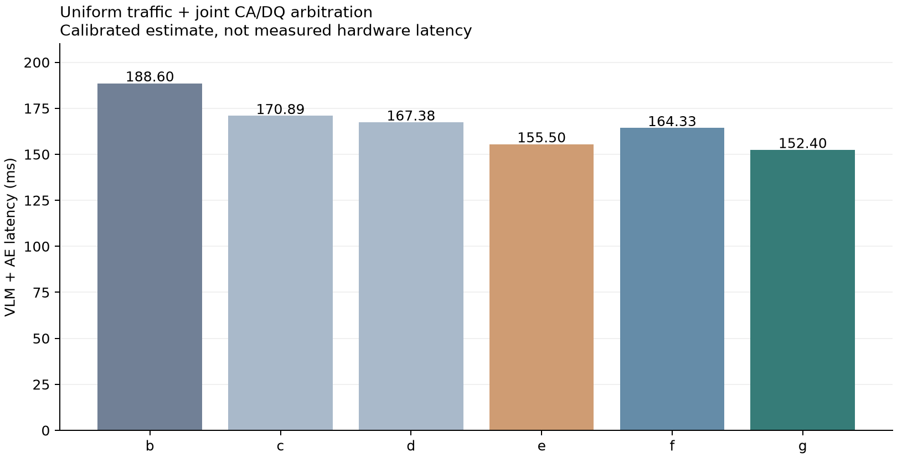

# b–g：均匀访存与 CA–DQ 联合仲裁估计

**本表是带明确假设的模型估计，不是 GPU/PIM 硬件端到端实测。** 主表保留已有 VLM latency，使用联合仲裁模型相对串行的净收益校准；原始模型绝对值同时保留。

作业 `1972086`；原生 PIM 输入仍来自修正基线 `evaluation-1971385`。融合前没有 rank controller、没有输入 DRAM staging，GPU 持续通过 WRGB 提供线性输入，计入 DQ 和共享 CA；融合后才启用 DRAM staging、本地读取、rank controller 与粗命令。

| 配置 | 定义 | AE 独立 / ms | AE GPU 等待 / ms | 净收益 / ms | 校准估计 / ms | 原始模型 / ms |
|---|---|---:|---:|---:|---:|---:|
| b | feature-wise / GPU RoPE / 融合前 / 串行 | 83.653 | 0.000 | 0.000 | **188.603** | 189.239 |
| c | feature-wise / GPU RoPE / 融合前 | 83.653 | 39.506 | 17.709 | **170.894** | 171.529 |
| d | 当前 layout / GPU RoPE / 融合前 | 80.560 | 39.367 | 18.135 | **167.375** | 168.011 |
| e | 当前 layout / 本地 RoPE / 融合前 | 69.601 | 25.744 | 19.050 | **155.502** | 156.137 |
| f | 当前 layout / GPU RoPE / 融合后 | 89.602 | 46.229 | 30.224 | **164.328** | 164.964 |
| g | 当前 layout / 本地 RoPE / 融合后 | 78.600 | 31.841 | 31.152 | **152.399** | 153.034 |

e → g：AE 自身增加 8.999 ms，净重叠收益增加 12.102 ms，所以总 latency 减少 **3.103 ms**。等待项没有遗漏；g 允许更多 VLM kernel 启动，因此它的 AE GPU 等待也可能更多。

## 计数来源与均匀假设

Thor 上重建了与已有记录一致的 OpenPI commit、三份核心源码、PyTorch 2.11.0 和 transformers 4.53.2。2353 个 kernel 的完整模板名称、依赖顺序、grid 和 block 与原始序列逐项匹配；另外 4 次 memcpy 使用 trace 中的实际字节数。已有 latency 不替换为 profiler 下的耗时。

读、写分开采集，每个 kernel 均验证只有 **1 pass**，避免多次 kernel replay 把读缺失变成热缓存结果。总 L2 读缺失为 11.804375 GB，L2 写 sector 代理为 8.028931 GB。每个 kernel 使用各自的计数，因此没有 ρ、预设在途请求数或固定读写比。

每个读缺失映射为一个 32B 请求；全部 L2 写 sector 暂按一次外存写回计费。这是全写回代理，**L2 写量不是测得的 DRAM 写量**。Thor 没有给出可用的直接 DRAM 字节计数；MCC 探测也没有取得有效底层计数。相关指标语义参见 [NVIDIA Nsight Compute Profiling Guide](https://docs.nvidia.com/nsight-compute/ProfilingGuide/)。

读流和写流分别在每个 kernel 的既有时长内均匀到达，扣除 CL+burst 的协议尾部；sector 均匀分配到 16 channel、4 bank group。GPU 请求使用 rank 0 的 row-hit 假设。没有重建 ACT/PRE、真实地址、缓存替换、warp 内依赖或 SM 级执行。

## 仲裁、依赖与等待

每次发射同时检查 CA 的 1 CK 指令槽、延迟后的完整 DQ burst、前后请求的读写/跨 rank 切换，以及目标 rank 的 refresh blackout。读返回为 CL=23 CK，写为 CWL=12 CK，burst=2 CK，tCK=0.938 ns；REF 占 CA 1 CK，目标 rank 的 nRFC=224 CK。另一个 rank 的 refresh 不把 GPU 全局停掉。

固定 PIM 优先级：GPU 只能填入不破坏已记录 PIM CA/DQ 时刻的合法槽位。模型使用完整 PIM reservation 日历，未模拟 GPU 反压改变 PIM 命令链。队列不设人为在途上限；表中观察到的在途数是结果。

无 PIM 时的请求完成时刻构成虚拟进度检查点。竞争使某个完成时刻延后，就推迟后续进度和请求发射；不把 CA/DQ 当下空闲直接兑换成 GPU 进度。kernel 保持原顺序，可跨多个窗口；PIM 结束时，已启动的 VLM kernel 完成后才运行 AE GPU 算子。

## 为什么列出原始模型和校准估计

原有 VLM = **104.950496 ms**；全写回同步代理在无 PIM 日历下的参考值 = **105.585917 ms**，偏差 **0.635421 ms**。短 kernel 的 L2 写可以先留在缓存，所以不能要求所有写回都在实测 kernel 时长内落到 DRAM。严格匹配旧时长的检查因此被拒绝，没有削减请求量来拟合。

`净收益 = 模型中已推进的 VLM 参考工作量 − 对 AE GPU 的等待`

`校准总延迟 = AE 独立 latency + 已有 VLM latency − 净收益`

`原始模型总延迟 = 校准总延迟 + VLM 参考偏差`

**校准假定无竞争模型的系统偏差在比较中近似抵消；该假定未通过真实并发硬件实验验证。** 两列不是置信区间，也不能当成真实 latency 的上下界。row-hit 与全写回代理有不同方向的误差，不能把整套结果称为严格保守界。

AE 沿用 18 层 × 10 步的原生阶段与已有 GPU ledger，采用 explicit native I/O 计费；本轮没有改动输入/输出去重口径。

## 验证与复现

18 项测试通过，包括独立逐 CK 穷举器对 100 个随机读/写探测的最早可用槽验证，以及 native CA 的 1/2/21 CK 完整占用回归检查。另对 640 份原生 channel 文件哈希、20 组配置、全部 kernel 顺序、字节数、等待和总延迟等式进行独立对账。验证仅证明所述模型的实现与数据一致，不证明模型等于硬件。

入口：`experiments/pi05-unified-gemv/uniform-transactions.sbatch`。机器可读结果见 `stream-reference/evaluation-b-g.csv`；每个配置的 VLM 放置与 AE 等待明细、原始计数、采集日志和 SHA256 清单随结果保存。

## e/g 差额与 CA/DQ 消融诊断

以下是同一模型内部的反事实检查：只删除指定的 PIM 总线占用，保留原有阶段长度、GPU 工作量、kernel 顺序、跨窗口执行、AE 等待、refresh 和 GPU 请求间读写切换。它们不是可部署配置，也不是额外硬件测量。

| 诊断 | e 总延迟 / ms | g 总延迟 / ms |
|---|---:|---:|
| 完整仲裁 | 155.502077 | 152.398690 |
| 仅取消 PIM CA 占用 | 155.282661 | 152.291521 |
| 仅取消 PIM DQ 占用 | 149.523726 | 148.547440 |
| 取消 PIM CA 与 DQ 占用 | 148.402089 | 147.897389 |

保留 DQ 时移除 PIM CA，e 只改善 0.219417 ms；保留 CA 时移除 PIM DQ，e 改善 5.978351 ms。两种效果互相耦合，不能直接相加。

本次 e/g 的每个 PIM 阶段都有在途 VLM kernel 覆盖（包括该 kernel 的阻塞时间）；模型净收益分别为 PIM 时间 27.916343/37.813744 ms 减去访存阻塞 8.866461/6.661634 ms。因此本次结果满足：总延迟 = 保留的 VLM 时长 + AE GPU 算子时长 + 模型访存阻塞。这个等式是当前调度结果的核对关系，不是另行使用空闲时间代替 GPU 进度。

e−g = AE GPU 算子差 0.898560 ms + 模型访存阻塞差 2.204828 ms。VLM 公共校准偏差不改变 e/g 的差额。

当前 native trace 的细粒度 MAC 发射间隔内仍有大量 CA 空槽；GPU 全 row-hit 抽象只需 RD/WR CA 槽，均匀分散到 channel 的请求还可以利用已知 PIM 日历来避开未来 DQ 冲突。没有真实地址、ACT/PRE、warp/CTA 内访存依赖及在线调度器的验证，因此这组消融只能解释代码为什么给出该差值，不能证明真实硬件的 e/g 差额只有这些。

## CA 导出修正

原导出器将所有 CA 命令截为 1 CK，遗漏 ACTAB 的第二个 CK，以及 MAC_RUN/ROPE_RUN 21 CK 描述符中的后 20 CK；现改为原生日志的 ready_at。共修正 7456 条 reservation，其他事件时刻及 DQ、refresh 完全不变。旧 e/g 分别为 155.499877/152.369836 ms，修正后为 155.502077/152.398690 ms。旧结果归档在 before-ca-duration-fix，本报告主表和消融均使用修正后的 CA。
