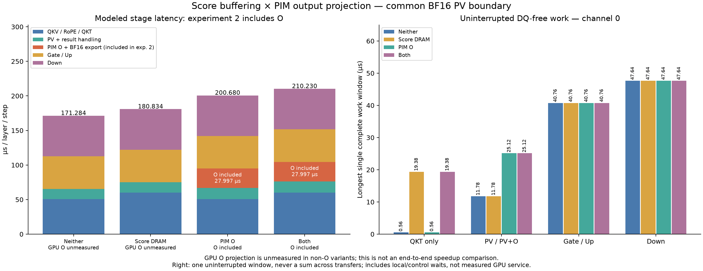
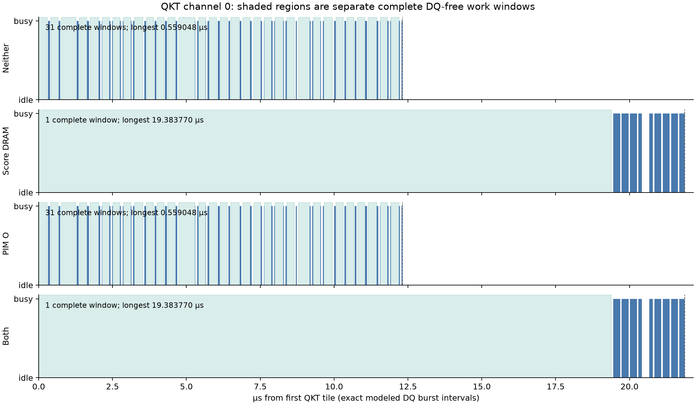

# QKT DRAM 暂存 × PIM O projection 四组实验

分支：`xinyao_1104_O_Projection`；原生性能作业：dev0 Slurm `1924418`。每组包含 4 个独立主阶段和 1 个连续单层控制案例，另外以同一 native binary 运行 5 个旧模式回归案例。

## 结果与口径

PV 与 O projection 均采用 BF16 操作数/权重、FP32 累加、BF16 写回/导出。四组 PV 的精度边界相同；QKT score 仍为 FP32。此前 FP32 PV 输出的 171.282552 µs 历史值保留作旧模式回归，不作为四组共同基线。

这次修正两处展示口径：**DQ 主比较使用最长连续完整工作窗口，不把分离窗口累加；实验 2 的 PV 阶段明确标为 PV+O，其 44.349578 µs 已包含 O projection。** 原来以累计无 DQ 时间为主的展示保留在 [previous-cumulative-report](previous-cumulative-report/)，原生运行数据没有改变。

“连续完整工作窗口”从完整的计算或本地操作阶段构建：先扣除前序 DQ burst 的尾部；相邻无 DQ 工作阶段可连接，中间仅有控制阶段时，只有整个控制段也无 DQ 才能连接。窗口两端的纯控制段不用于延长窗口。任何含外部传输命令的阶段都会切断窗口，即使该传输阶段内部存在 DQ idle 间隙，也不把这些间隙算作完整工作窗口。不同独立案例不拼接。

下表是 channel 0 在指定工作范围内的**最长一个窗口**，单位 µs；每行独立取最大值，各行之间不相加。

| 工作范围 | 非1非2 | 1非2 | 2非1 | 1和2 |
|---|---:|---:|---:|---:|
| QKT | 0.559048 | 19.383770 | 0.559048 | 19.383770 |
| PV；实验 2 为 PV+O | 11.784094 | 11.784094 | 25.124330 | 25.124330 |
| Gate / Up | 40.757038 | 40.757038 | 40.757038 | 40.757038 |
| Down | 47.638206 | 47.638206 | 47.638206 | 47.638206 |

原 QKT 有 31 个由 score 导出隔开的工作窗口，最长 0.559048 µs；实验 1 将这些导出移到末尾，形成 1 个 19.383770 µs 的连续窗口。PV 基线只有 1 个 11.784094 µs 窗口；实验 2 的 PV+O 有 2 个窗口，最长 25.124330 µs，另一个由 O tile 0 导出隔开。它们不能相加后称为连续。完整 QKV/RoPE/QKT/V chain 的最长窗口四组均为 32.435102 µs，该最大值掩盖了 QKT 子区间的改善，因此主表单列 QKT。

窗口包含内部计算、本地读写、等待、refresh，以及连接工作阶段的无 DQ 控制段；**不等于 MAC 持续活跃时间，也不是已测 GPU 可用时间**。物理 DQ burst 补集得到的“最长 DQ 空闲区间”另行保留，但它还会包含传输阶段内部的间隙，与这里的完整工作窗口不同。各 channel、范围和窗口的起止时间及关联阶段见 [continuous-dq.json](continuous-dq/continuous-dq.json)、[范围汇总](continuous-dq/continuous-dq-summary.csv)和[逐连续工作窗口](continuous-dq/continuous-dq-complete-work-windows.csv)。

## 时延与 DQ 总量核算

以下 latency 单位均为 µs/层/denoising step，是四个独立阶段的墙钟时间之和，不代表一个连续窗口。DQ utilization 使用 channel 0 的已发出命令 burst 占用时间除以对应墙钟时间。其余 15 个 channel 也独立核查，见 [channel 数据](channel-comparison.csv)。这些累计数据作为次要核算项保留。

**非实验 2 组尚未计入 GPU O projection；所有组尚未计入 GPU softmax、最终跨 rank 求和、norm/residual、非线性和后台竞争。下表比较的是已建模工作，不能直接判断端到端加速。**

| 组合 | 主路径 latency | 相对基线增加 | DQ busy/ch0 | DQ utilization/ch0 | 外部 DQ 总量/KiB |
|---|---:|---:|---:|---:|---:|
| 非1非2（GPU O 未计时） | 171.284428 | 0 | 16.478784 | 9.621% | 4392 |
| 1非2（GPU O 未计时） | 180.834206 | 9.549778 | 16.478784 | 9.113% | 4392 |
| 2非1（已计 PIM O） | 200.680410 | 29.395982 | 17.919552 | 8.929% | 4776 |
| 1和2（已计 PIM O） | 210.230188 | 38.945760 | 17.919552 | 8.524% | 4776 |

| 阶段 | 非1非2 | 1非2 | 2非1 | 1和2 |
|---|---:|---:|---:|---:|
| QKV / RoPE / QKT / V 本地写回 | 50.511300 | 60.061078 | 50.511300 | 60.061078 |
| PV → BF16 输出；实验 2 为 PV → DRAM → PIM O → BF16 输出 | 14.953596 | 14.953596 | 44.349578 | 44.349578 |
| Gate / Up | 47.127934 | 47.127934 | 47.127934 | 47.127934 |
| Down | 58.691598 | 58.691598 | 58.691598 | 58.691598 |
| 独立阶段之和 | 171.284428 | 180.834206 | 200.680410 | 210.230188 |
| 连续单层控制（另列） | 171.960726 | 181.253492 | 201.204752 | 210.646660 |

连续控制不重复加进主路径。独立阶段相加时两个开关分别影响 chain 和 PV，因此差分按构造可加；连续控制中的 2×2 交互为 `210.646660−181.253492−201.204752+171.960726 = 0.149142 µs`，反映连续内存调度/refresh 等影响。

保留的累计拆分满足 `墙钟时间 = DQ busy + 累计完整无 DQ 工作 phase 时长 + 其余 DQ idle`。这是时间账目，不能用中间一项表示连续窗口：

| 组合 | DQ busy | 累计完整无 DQ 工作 phase 时长 | 其余 DQ idle | 累计 DQ 与全局 CA 同时空闲 |
|---|---:|---:|---:|---:|
| 非1非2 | 16.478784 | 141.210272 | 13.595372 | 146.429304 |
| 1非2 | 16.478784 | 151.993520 | 12.361902 | 156.272676 |
| 2非1 | 17.919552 | 164.788778 | 17.972080 | 173.098520 |
| 1和2 | 17.919552 | 175.572026 | 16.738610 | 182.941892 |

“累计完整无 DQ 工作 phase 时长”是按 semantic phase 分类并扣除前序数据尾部后的总和；它跨越了传输分隔，也跨越独立阶段，不能替代前面的最长连续指标。DQ/CA 同时空闲也是累计资源空闲交集，未注入并发 GPU 请求，不能视为已测 GPU 服务时间。实际 DQ 区间沿用 AttAcc 模型，普通 DRAM RD/WR 计入 CL/CWL；它不是经电气验证的 LPDDR 波形。

## 原 QKT 为什么出现间歇 DQ

每个 head 由两个不同 channel 上的 PIM rank 负责，K/V token 按奇偶分片；每 rank 的 16 bank 分摊 256 个 head feature。Q 经过交换后，每 bank 持有 16 query × 16 lane 的 BF16 输入。一次 `PIM_MAC_QK` 使用一个本地 K token，计算 16 query 的 bank 部分和，再完成 BG/rank 归约。

原路径每处理 16 个本地 K token，立即用 `PIM_RD_BG` 导出一个 `16×16×FP32 = 1 KiB` score tile；共 31 个 tile。于是 QKT 整段实际上是“计算 → 导出 → 计算 → 导出”。MAC、bank 内 K 读取和归约不占外部 DQ，但夹在它们之间的 score 导出占用 DQ，产生间歇脉冲。QKT 前面的 Q 交换另包含 64 KiB 读出和 64 KiB 写入。

实验 1 用 `PIM_SCORE_SPILL` 将每个完整 tile 经过本地端口存入 bank0/4，确认写入与 recovery 完成后才复用 score tile；31 tile 全部落地后，用普通 `LD` 统一读给 GPU。每 rank 存 31 KiB score，每个源 bank 15.5 KiB；全系统 score 仍为 496 KiB（含 padding），没有减少最终输出字节数。

该图从首个 QKT tile 开始显示 channel 0 的精确模型 DQ burst 区间，避免分桶平均把传输画进相邻的空闲窗口。阴影是逐个完整工作窗口，虚线标出该组 QKT 结束。最长连续完整工作窗口从 0.559048 µs 增至 19.383770 µs。实验 1 同时增加本地写回与普通 DRAM read 的行准备/返回等待，使 chain 增加 9.549778 µs；窗口更长和总时延增加可以同时发生。完整分阶段数值见 [stage-comparison.csv](stage-comparison.csv)，逐 phase 见 [phase-comparison.csv](phase-comparison.csv)。

## 当前 PV layout 如何继续做 O projection

每个 rank 保存一个 head 的奇/偶 KV token 分片贡献 `C[h,p] = P[:,Kp] V[Kp,:]`，形状 `[16,256]`，并非完整跨 rank attention 输出。忽略舍入时，线性关系允许 `Y = Σ(h,p) C[h,p] W_O[h]`：各 rank 先计算，再由 GPU 对 8 heads × 2 parity 的 16 份 `[16,1024]` 部分结果求和。若有 bias，应在最终求和后加一次。

实验 2 的 44.349578 µs 是 **PV+O 全路径**，并非只测 PV。原生 `phase_us` 给出的拆分如下；非实验 2 两组数值相同，实验 2 两组数值也相同。

| 时延组成 / µs | 非实验 2：PV → BF16 输出 | 实验 2：PV → DRAM → PIM O → BF16 输出 |
|---|---:|---:|
| P 输入暂存 | 1.2438173125 | 1.2438173125 |
| PV 本地读取、广播与计算 | 11.784094 | 11.784094 |
| PV release | 0.002814 | 0.002814 |
| 共同边界开销 | 0.0009086875 | 0.0009086875 |
| PV BF16 结果导出 | 1.921962 | — |
| PV 结果本地写入 DRAM | — | 3.320520 |
| O tile 0 / 1 读取、广播与计算 | — | 10.016902 + 10.241084 = 20.257986 |
| O tile 0 / 1 BF16 结果导出 | — | 3.866436 + 3.865498 = 7.731934 |
| O 两次 release 与一次 rewind | — | 0.007504 |
| **总时延** | **14.953596** | **44.349578** |

O 子流程本身为 `20.257986 + 7.731934 + 0.007504 = 27.997424 µs`；加上 PV 结果落 DRAM 后，尾部为 31.317944 µs。与基线相比，新增尾部替换了原 PV 导出，因此净增量为 `3.320520 + 27.997424 − 1.921962 = 29.395982 µs`，**29.395982 µs 不是纯 O 耗时**。其中 20.257986 µs 也包含操作数读取、广播和调度等待，不能称为纯 MAC 活跃时间。证据见 [PV 基线 summary](neither/pv/summary.json)和 [PV+O summary](oproj_only/pv/summary.json)。

PV+O 的首个连续工作窗口把 PV 计算、PV release、PV 本地写回与 O tile 0 计算连接起来：`11.784094 + 0.002814 + 3.320520 + 10.016902 = 25.124330 µs`。O tile 0 导出切断窗口，之后 O tile 1 计算形成另一个 10.241084 µs 窗口；导出和边缘控制段不加进窗口。不开实验 2 时 GPU O projection 的耗时未测，所有组的最终 GPU 归约也未测，因此上述净增量不能用来判断完整 O offload 的端到端快慢。

实施步骤：

1. 从各 feature bank 的 FP32 PV 累加器 gather 16 个元素，转换成 32 B BF16 packet，写入 bank0 或 bank4。每 rank 暂存 8 KiB，全部写完才 SEAL。
2. 保留现有 pair-major feature 顺序；每个 source feature bank 对应一个 512 B fragment。相邻两个 fragment 从两个源 bank 读取，填满 1 KiB SRF，并广播至全部 16 bank。
3. 每 bank 的 2 KiB FP32 输出池一次容纳 16 query × 32 output，O projection 分成两个输出 tile。第一 tile 全部导出并释放后，显式 rewind，再扫描同一份 DRAM 输入。
4. 每 rank 导出 32 KiB BF16 部分结果；全系统导出 512 KiB，再由 GPU 做最终求和。不开实验 2 时 PV 导出为 128 KiB，所以开启后净增加 384 KiB 外部 DQ。

每 rank 的完整 W_O 常驻副本为 `[2048,1024]` BF16，4 MiB/rank、总 64 MiB；每个 bank 预留 `[786432,1048576)` 共 256 KiB。按 rank 对 head 块作循环排列，使当前 rank 所属 head 位于 slot0，当前活跃权重地址保持不变。每次只读取所属 head 的 `[256,1024]` 子块，即全系统 8 MiB 活跃权重，另外 56 MiB 预置后不读取。

完整常驻容量布局是测量后的补充约束，已有独立映射/边界/兼容性测试；20 组重新生成的 trace 与配置和测量输入逐项一致。冻结的 native metadata 记录的是活跃权重子块，未模拟完整矩阵初始化；64 MiB 的预安装流量/时间不计入稳态 step。最终常驻布局见 [o-projection-layout.json](o-projection-layout.json)，原运行与发布代码的差别完整记录在 [source-result-binding.json](source-result-binding.json)。

转换路径显式建模单个 64 B FP32 scratch：每 16 元素 gather 用 4 CK、BF16 cast 用 2 CK，本地 staging 还需 2 CK transfer，随后真实 LOCALWR/recovery。scratch、local port、CA 的占用与复用均检查；这些端口和转换服务时间是架构假设，未做电路测量。

相比先在 GPU 合并 PV 再投影一次，这种按 token 分片先投影的方法将 Wo 乘加工作重复两份。四组都在 PV rank partial 处转 BF16，实验 2 还在 O rank partial 导出处再转 BF16；因此最终舍入和归约顺序不同，不能宣称数值逐位相同。模拟器执行时序和数据映射契约，尚未验证模型精度。

## 验证与复现证据

- 原实验的 141 项 Python 测试通过；73 项 native guards（52 项旧 guards、8 项 score guards、13 项 O guards）通过。这些计数对应已有原生实现与审计验证；本次连续窗口分析的新增测试单列在 [连续窗口复核](continuous-review-validation.json)，不混入旧计数。
- O 的 `O_missing_rewind` 原来预期另一条报错文字；实际 native 更早以 `duplicate staging load` 拒绝。只修正断言文字，并在同一 binary 上重试同一 SHA256 trace；原失败日志和完整修正过程保留在 [assertion-correction.json](tests/assertion-correction.json)。
- 四组共 20 个案例逐项核查全部 16 channel 的命令/地址覆盖、SRF/累加器容量、两源 bank producer/consumer、ACT1/ACT2、write recovery、CA/DQ 冲突及数据依赖。补充审计还检查跨 packet scratch 和跨 generation DRAM 暂存复用。
- 同一新版 binary 的 5 个旧模式案例与历史档案在 cycle、trace、流量和原生命令事件 SHA 上完全一致，见 [validation.json](validation.json)。
- 测量、原生检查、单项重试和补充审计分开记录。测量 source snapshot 未改；最终发布代码的 native/adapter 与之逐字节相同，报告/审计和常驻权重契约的后续变动单列。

[来源绑定](source-result-binding.json)、[补充验证](postchecks/summary.json)、[原生来源](provenance.json)、[原始归档 SHA256](archive-manifest.json)、[实现与复现命令](../../experiments/pi05-unified-gemv/O-PROJECTION.md)。
