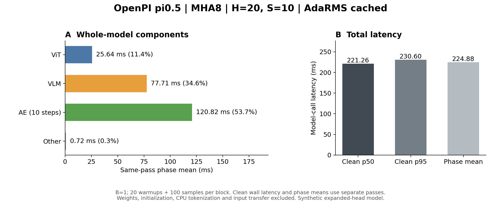
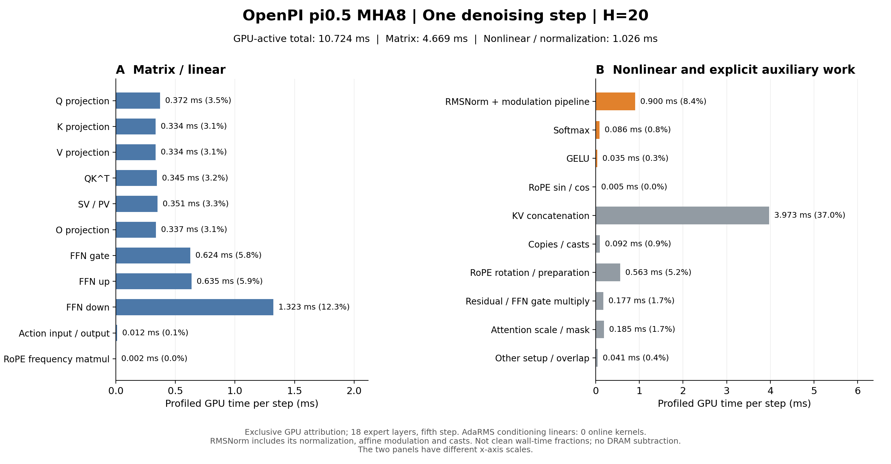
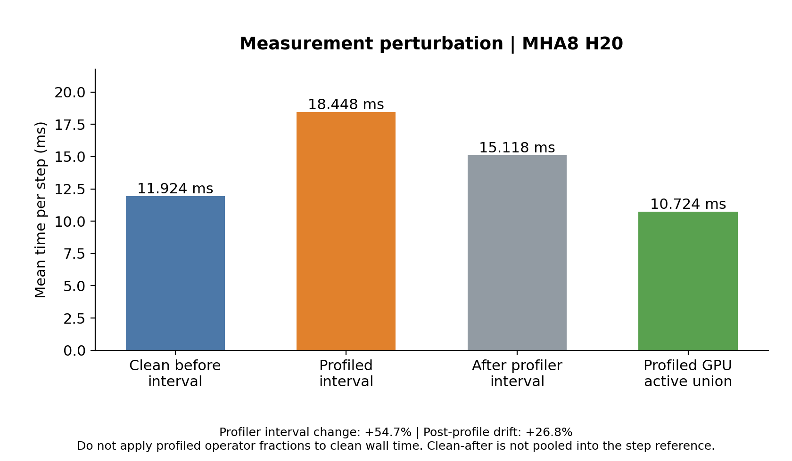

# OpenPI pi0.5 MHA8 H20/S10 Latency

Completed 2026-10-22, Asia/Hong_Kong. Same cached OpenPI baseline as the previous round.
Both VLM and AE have 8 query/KV heads, head_dim=256. Q/O, ViT, residual and FFN widths unchanged.

## Whole Model

Clean p50 **221.256 ms**, p95 230.602 ms; 200 clean samples.

| Phase | Mean ms | Same-pass share |
|---|---:|---:|
| VIT | 25.638 | 11.40% |
| VLM | 77.706 | 34.55% |
| AE | 120.817 | 53.73% |
| OTHER | 0.720 | 0.32% |

Phase total 224.880 ms. Phase overhead +0.969%; before/after drift +0.647%.
ViT is not counted again in VLM; AE includes all ten steps and Euler updates. Model inputs are fixed synthetic GPU-resident tensors.

## One AE Step

Clean-before step p50 **11.845 ms**, mean 11.924 ms.
Profiled GPU-active union **10.724 ms**, excluding launch gaps. The following are exclusive same-pass sums:

| GPU category | Mean ms | GPU-active share |
|---|---:|---:|
| Matrix / linear | 4.668502 | 43.53% |
| Movement / pointwise / setup | 5.019852 | 46.81% |
| Nonlinear / normalization | 1.025649 | 9.56% |
| Shared overlap | 0.010304 | 0.10% |

The real fifth denoising step includes all 18 layers and action input/output projections; outer Euler update is excluded.
Nonlinear/normalization includes GELU, explicit Softmax, RoPE sin/cos and the entire RMSNorm/modulation pipeline (including casts and affine work).
Matrix includes Q/K/V/O, QK/SV, FFN gate/up/down, action I/O and the small RoPE frequency matmul.
Remaining KV concatenation, casts, rotations, residual/gating, attention scaling/masks and setup are auxiliary, not all nonlinear.
The conditioning cache has 370 hits per full request and zero online conditioning-linear kernels per measured step.

## Interpretation

Profiler interval overhead +54.72%; post-profile drift +26.79%.
Do not apply these profiled fractions to clean wall latency. Clean-after step timings are not pooled into the clean-before reference.
This is native model-step profiling, NOT independent per-operator microbenchmark summation and NOT a PIM/GPU execution measurement. No DRAM subtraction or cache flushing.

## Geometry and Validation

VLM: D=2048, FFN=16384, 18 layers. AE: D=1024, FFN=4096, 18 layers. Both attention inner widths=2048.
Actual AE QK: [8,20,256] x [8,256,988]; SV: [8,20,988] x [8,988,256]. Prefix KV=136.125 MiB.
Four cache-on/off action comparisons are bitwise equal; all fine instrumentation outputs are bitwise equal. Twenty single-stream kernel sequences match labels exactly.
Synthetic KV-head duplication is not a trained MHA8 policy. Maximum action relative-RMS difference from original MQA on four fixtures: 0.0000%. No task-quality claim.
Six CPU mapping/analysis tests pass. Detailed scalar operation and tensor-shape ledgers accompany the figures.

Branch: `research/thor-openpi-mha8-h20-latency-20261022`. Not pushed automatically.
